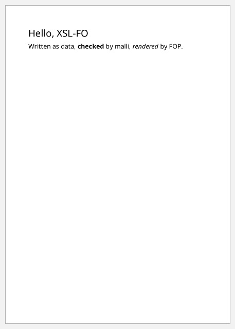

# clj-xml-fo documentation

[XSL-FO](https://www.w3.org/TR/xsl11/) is the W3C language for laying out
print documents: pages, columns, tables, footnotes and running headers.
clj-xml-fo lets you write it as Clojure data. Malli checks the data, and Apache
FOP turns it into PDF, PNG and other formats.

These pages go through the XSL-FO feature set one topic at a time, mostly by
example. Under each example is a screenshot of what FOP made from it, and
clicking the screenshot opens the PDF.

```clojure example=readme-hello
(require '[clj-xml-fo.core :as fo])

[:root
 {:layout-master-set {:xml/value [[:simple-page-master {:master-name "A5" :page-width "148mm" :page-height "210mm"
                                                        :margin "15mm" :region-body {}}]]}
  :page-sequence     [{:master-reference "A5"
                       :flow {:flow-name "xsl-region-body"
                              :xml/value [[:block {:font-size "18pt" :space-after "6pt" :xml/value ["Hello, XSL-FO"]}]
                                          [:block {:xml/value ["Written as data, "
                                                               [:inline {:font-weight "bold"} "checked"] " by malli, "
                                                               [:inline {:font-style "italic"} "rendered"] " by FOP."]}]]}}]}]
```

[](examples/readme-hello.pdf)

```clojure no-eval
(fo/valid? doc)              ; => true
(fo/render! doc "hello.pdf") ; => {:page-count 1, ...}
```

## Contents

**The basics**

- [The data model](data-model.md): elements, attributes, keyed children,
  `:xml/value`, and hiccup in mixed content. Read this first.
- [Page layout](page-layout.md): page masters, regions, sizes, first-page
  and odd/even masters, title pages, page numbering.
- [Validation](validation.md): `valid?`, `explain` and `validate`, strict versus
  lenient, and schemas in your own specs.
- [Rendering](rendering.md): output formats, FOP factories, fonts, metadata,
  FO XML and SAX.

**Text and boxes**

- [Text](text.md): fonts, sizes, colours, alignment, indents, decoration,
  superscript, preformatted code, `wrapper`, `character`.
- [Spacing, borders and backgrounds](spacing-borders-backgrounds.md): the
  block box model, border styles, background images.
- [Leaders and rules](leaders.md): horizontal rules, dot leaders, right-aligned
  text, signature lines.

**Structure**

- [Lists](lists.md): bulleted, numbered, nested, styled and definition lists.
- [Tables](tables.md): column widths, spans, alignment, data-driven rows,
  repeating headers, border models.
- [Block containers](block-containers.md): fixed sizes, overflow, vertical
  alignment, rotation, absolute and fixed positioning.
- [Multi-column layout](columns.md): column counts, spanning headings, a
  newspaper page.
- [Images and SVG](images-and-svg.md): image files, sizing, figures, inline SVG,
  charts from data.

**Navigation and pagination**

- [Headers and footers](headers-and-footers.md): static content, page numbers,
  "page N of M", different first page, odd/even headers.
- [Links, cross-references and tables of contents](links-and-toc.md): ids,
  internal and external links, page citations, a generated TOC.
- [Footnotes](footnotes.md): footnotes, separators, numbering from data.
- [Markers](markers.md): running chapter headers, dictionary headers.
- [Page breaks and keeps](breaks-and-keeps.md): forced breaks, keep-together,
  keep-with-next, widows and orphans.

**Big documents**

- [Streaming](streaming.md): lazy and reducible content, rows from a database,
  one page-sequence per record.

**Reference**

- [Element reference](element-reference.md): every element, how its content is
  written, and what it may contain. Generated from the schema.

## Reading the examples

- An example is either a whole `[:root ...]` document or **flow content**: one
  element, or a vector of them, that goes in a flow's `:xml/value`. Screenshots
  of flow content put it on an A5 page and crop it.
- Attribute values are strings in XSL-FO syntax: `"12pt"`, `"#2E75B6"`,
  `"solid 1pt gray"`.
- A few examples use XSL-FO functions such as `label-end()`, or CSS-style
  border shorthands, which strict `fop.xsd` doesn't accept. Those pages say so,
  and the examples validate with `{:lenient? true}`. See
  [validation.md](validation.md#strict-and-lenient).
- Image paths like `url('images/logo.svg')` resolve against the FOP factory's
  base URI, which is `doc/` for these pages.

## The examples are tested

Every Clojure block on these pages is run by the test suite
(`clj-xml-fo.docs-test`). Each one must:

- run without error, and match every `;; =>` result it states
- be valid FO data, strictly unless marked lenient
- render through FOP with no errors or warnings, unless the warning is the point
- have its PDF and screenshot under [`examples/`](examples/)

To regenerate the PDFs, screenshots and the element reference after changing
a page, run:

```bash
clojure -X:docs
```

## Not covered

Some XSL-FO is outside what this library can express, or what FOP supports:

- **XSL 1.1 additions** aren't in `fop.xsd`, which describes XSL-FO 1.0. That
  rules out bookmarks, `page-number-citation-last`, change bars and table
  markers.
- **FOP limitations:**
  - `fo:float` is partial.
  - `fo:multi-*` is partial or missing.
  - `table-and-caption` needs FOP 2.12.
  - `visibility` is ignored.
  - `table-layout="auto"` isn't supported.
  - `text-align` takes only `start`, `end`, `center` and `justify`.

  Apache FOP's [compliance page](https://xmlgraphics.apache.org/fop/compliance.html)
  has the details.
- **Hyphenation** needs hyphenation patterns, which FOP doesn't bundle.
