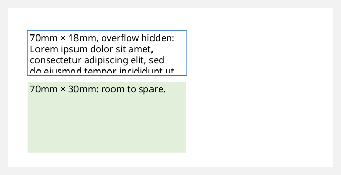
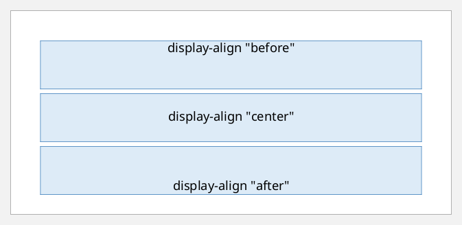
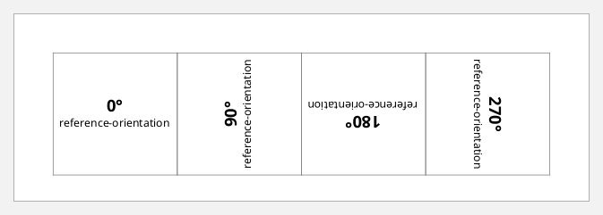
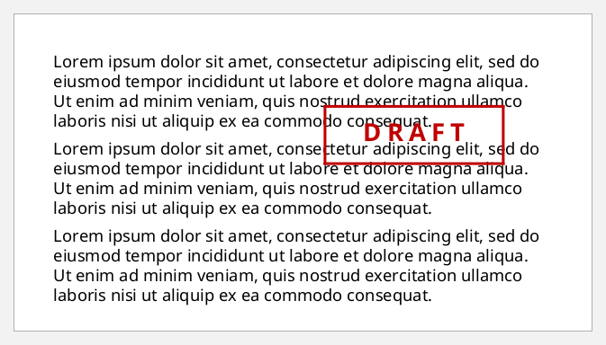
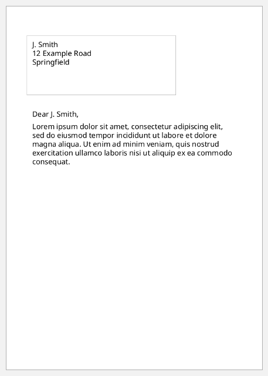

# Block containers

A `block-container` is a box with its own coordinate system. Plain blocks
can't do what it does:
- **Fixed size:** `:width` and `:height`, with `:overflow` for what doesn't fit.
- **Vertical alignment:** `:display-align` places the content `"before"`
  (top), `"center"` or `"after"` (bottom).
- **Rotation:** `:reference-orientation` turns the content by `"90"`, `"180"`
  or `"270"` degrees.
- **Positioning:** `:absolute-position "absolute"` or `"fixed"`, together with
  `:top`, `:left`, `:right` and `:bottom`, takes the box out of the flow.

Its `:xml/value` is element content: blocks, tables, lists.

```clojure
(def lorem
  (str "Lorem ipsum dolor sit amet, consectetur adipiscing elit, sed do eiusmod tempor "
       "incididunt ut labore et dolore magna aliqua. Ut enim ad minim veniam, quis nostrud "
       "exercitation ullamco laboris nisi ut aliquip ex ea commodo consequat."))
```

## Fixed size and overflow

A container's height is fixed even when its content needs more, and
`:overflow "hidden"` clips the excess. A plain block would grow instead. FOP
logs a warning when it clips, as it does here:

```clojure example=containers-fixed-size warns
[[:block-container {:width "70mm" :height "18mm" :overflow "hidden"
                    :border "solid 1pt #2E75B6" :padding "3pt" :space-after "8pt"
                    :xml/value [[:block {:xml/value ["70mm × 18mm, overflow hidden: " lorem]}]]}]
 [:block-container {:width "70mm" :height "30mm" :background-color "#E2EFDA" :padding "3pt"
                    :xml/value [[:block {:xml/value ["70mm × 30mm: room to spare."]}]]}]]
```

[](examples/containers-fixed-size.pdf)

## Vertical alignment

`:display-align` positions the content inside a container that is taller than
it needs to be:

```clojure example=containers-display-align
(vec (for [align ["before" "center" "after"]]
       [:block-container {:height "16mm" :display-align align :background-color "#DDEBF7"
                          :border "solid 0.5pt #2E75B6" :space-after "4pt"
                          :xml/value [[:block {:text-align "center" :xml/value [(str "display-align \"" align "\"")]}]]}]))
```

[](examples/containers-display-align.pdf)

## Rotation

`:reference-orientation` rotates the container's content counter-clockwise.
Here four rotated containers sit side by side in a table:

```clojure example=containers-rotation
(defn rotated [deg]
  {:padding "2pt" :border "solid 0.5pt gray"
   :xml/value [[:block-container {:reference-orientation deg :height "30mm" :width "30mm" :display-align "center"
                                  :xml/value [[:block {:text-align "center" :font-weight "bold" :xml/value [(str deg "°")]}]
                                              [:block {:text-align "center" :font-size "8pt" :xml/value ["reference-orientation"]}]]}]]})

[:table {:table-layout "fixed" :width "100%"
         :table-column [{:column-width "proportional-column-width(1)" :number-columns-repeated "4"}]
         :table-body   [{:xml/value [[:table-row {:table-cell (mapv rotated ["0" "90" "180" "270"])}]]}]}]
```

[](examples/containers-rotation.pdf)

A sideways table heading or a vertical label down a page margin is a
rotated container.

## Absolute positioning

`:absolute-position "absolute"` takes the container out of the flow and
places it relative to the region it is in. The flow carries on underneath as
if the box weren't there. That suits stamps and overlays:

```clojure example=containers-absolute
[[:block {:space-after "6pt" :xml/value [lorem]}]
 [:block {:space-after "6pt" :xml/value [lorem]}]
 [:block-container {:absolute-position "absolute" :top "14mm" :left "70mm" :width "45mm" :height "14mm"
                    :border "solid 2pt #C00000" :display-align "center"
                    :xml/value [[:block {:text-align "center" :font-size "18pt" :font-weight "bold" :color "#C00000"
                                         :letter-spacing "4pt" :xml/value ["DRAFT"]}]]}]
 [:block {:xml/value [lorem]}]]
```

[](examples/containers-absolute.pdf)

## Fixed to the page: an envelope window

`:absolute-position "fixed"` measures from the page itself, not the region.
That suits printing an address where a window envelope needs it:

```clojure example=containers-fixed
[:root
 {:layout-master-set {:xml/value [[:simple-page-master {:master-name "letter" :page-width "148mm" :page-height "210mm"
                                                        :margin "15mm" :region-body {:margin-top "45mm"}}]]}
  :page-sequence
  [{:master-reference "letter"
    :flow {:flow-name "xsl-region-body"
           :xml/value [[:block-container {:absolute-position "fixed" :top "20mm" :left "15mm" :width "80mm" :height "28mm"
                                          :border "dashed 0.5pt #A6A6A6" :padding "3mm"
                                          :xml/value [[:block {:xml/value ["J. Smith"]}]
                                                      [:block {:xml/value ["12 Example Road"]}]
                                                      [:block {:xml/value ["Springfield"]}]]}]
                       [:block {:space-after "6pt" :xml/value ["Dear J. Smith,"]}]
                       [:block {:xml/value [lorem]}]]}}]}]
```

[](examples/containers-fixed.pdf)

The dashed border marks where the envelope window would be. The letter's text
starts below it, because region-body has a 45mm top margin.
