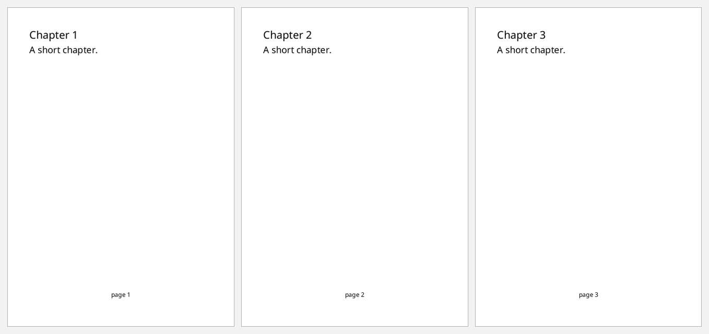
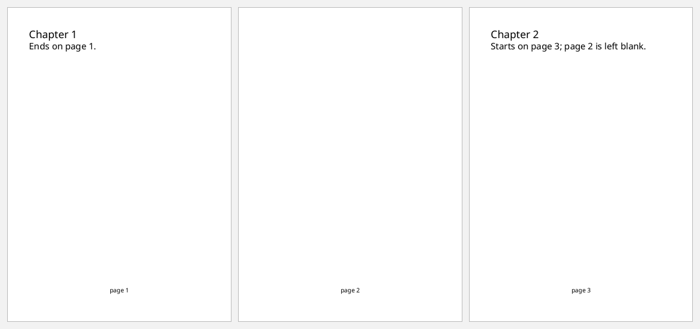
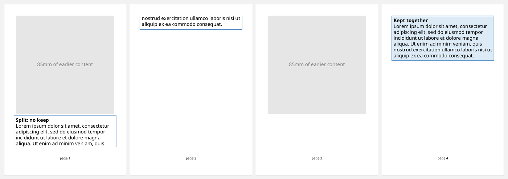
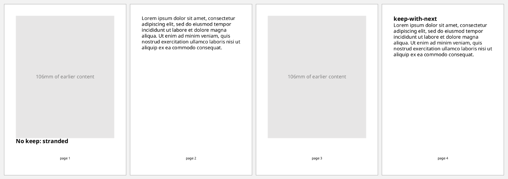
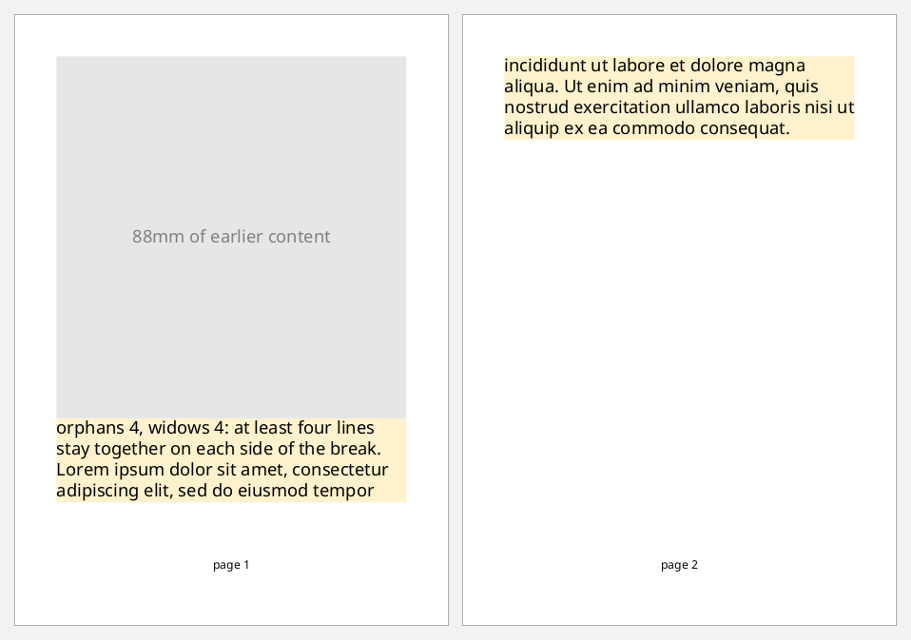

# Page breaks and keeps

FOP breaks pages wherever content runs out of room. Two families of properties
steer it:

- **Breaks** force a break: `:break-before` and `:break-after`, with `"page"`,
  `"odd-page"`, `"even-page"` or `"column"`.
- **Keeps** forbid one:
  - `:keep-together "always"` keeps a block on one page.
  - `:keep-with-next` and `:keep-with-previous` keep neighbours together.
  - `:widows` and `:orphans` set the fewest lines of a paragraph left alone at
    the top or bottom of a page.

The examples use small A6 pages, with a tall grey box standing in for earlier
content, so the breaks are easy to see:

```clojure
(defn a6-document [items]
  [:root
   {:layout-master-set {:xml/value [[:simple-page-master {:master-name "a6" :page-width "105mm" :page-height "148mm"
                                                          :margin "10mm" :region-body {:margin-bottom "8mm"}
                                                          :region-after {:extent "6mm"}}]]}
    :page-sequence     [{:master-reference "a6"
                         :static-content [{:flow-name "xsl-region-after"
                                           :xml/value [[:block {:font-size "8pt" :text-align "center" :xml/value ["page " [:page-number]]}]]}]
                         :flow {:flow-name "xsl-region-body" :xml/value (vec items)}}]}])

(defn filler
  "A grey box of the given height, standing in for earlier content."
  [height]
  [:block-container {:height height :background-color "#E7E6E6" :display-align "center"
                     :xml/value [[:block {:text-align "center" :color "gray" :xml/value [(str height " of earlier content")]}]]}])

(def lorem
  (str "Lorem ipsum dolor sit amet, consectetur adipiscing elit, sed do eiusmod tempor "
       "incididunt ut labore et dolore magna aliqua. Ut enim ad minim veniam, quis nostrud "
       "exercitation ullamco laboris nisi ut aliquip ex ea commodo consequat."))
```

## Starting on a new page

`:break-before "page"` starts every chapter on a fresh page, however little is
on the previous one:

```clojure example=breaks-page
(a6-document
 (for [title ["Chapter 1" "Chapter 2" "Chapter 3"]]
   [:block {:break-before "page" :xml/value [[:block {:font-size "14pt" :space-after "4pt"} title]
                                             [:block "A short chapter."]]}]))
```

[](examples/breaks-page.pdf)

The first chapter's break has no effect, because the flow is already at the
top of page 1.

## Starting on a right-hand page

`:break-before "odd-page"` skips to the next odd page, leaving a blank even
page if need be. Books use this so chapters open on the right:

```clojure example=breaks-odd-page
(a6-document
 [[:block {:font-size "14pt" :xml/value ["Chapter 1"]}]
  [:block {:xml/value ["Ends on page 1."]}]
  [:block {:break-before "odd-page" :font-size "14pt" :xml/value ["Chapter 2"]}]
  [:block {:xml/value ["Starts on page 3; page 2 is left blank."]}]])
```

[](examples/breaks-odd-page.pdf)

## Keeping a block together

Without a keep, a block that doesn't fit is split across pages. With
`:keep-together.within-page "always"`, the whole block moves to the next page:

```clojure example=breaks-keep-together
(defn boxed [props title]
  [:block (merge {:border "solid 1pt #2E75B6" :padding "4pt" :space-before "4pt"
                  :xml/value [[:block {:font-weight "bold"} title] lorem]}
                 props)])

(a6-document
 [(filler "85mm")
  (boxed {} "Split: no keep")
  (assoc-in (filler "85mm") [1 :break-before] "page")
  (boxed {:background-color "#DDEBF7" :keep-together.within-page "always"} "Kept together")])
```

[](examples/breaks-keep-together.pdf)

## Keeping a heading with what follows

A heading alone at the bottom of a page looks broken. In the first half below,
the heading fits on page 1 but its paragraph doesn't, so the heading is left
stranded. In the second half, `:keep-with-next "always"` moves the heading to
the next page with its paragraph:

```clojure example=breaks-keep-with-next
(a6-document
 [(filler "106mm")
  [:block {:font-size "14pt" :font-weight "bold" :xml/value ["No keep: stranded"]}]
  [:block {:xml/value [lorem]}]
  (assoc-in (filler "106mm") [1 :break-before] "page")
  [:block {:font-size "14pt" :font-weight "bold" :keep-with-next "always" :xml/value ["keep-with-next"]}]
  [:block {:xml/value [lorem]}]])
```

[](examples/breaks-keep-with-next.pdf)

## Widows and orphans

`:orphans` is the fewest lines left at the bottom of a page, and `:widows` the
fewest carried to the top of the next. Both default to 2. With 4, FOP moves
lines across the page break to keep a paragraph from leaving stragglers:

```clojure example=breaks-widows-orphans
(a6-document
 [(filler "88mm")
  [:block {:orphans "4" :widows "4" :background-color "#FFF2CC"
           :xml/value ["orphans 4, widows 4: at least four lines stay together on each side of the break. " lorem]}]])
```

[](examples/breaks-widows-orphans.pdf)

FOP's compliance notes: keeps work on block-level objects, with "minimal
support" for integer strengths, so use `"always"`.
