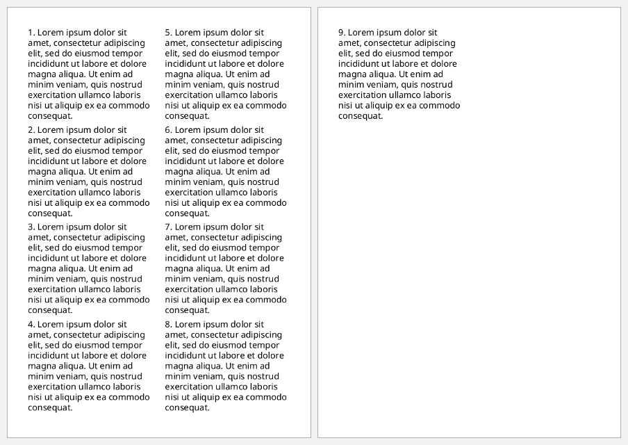
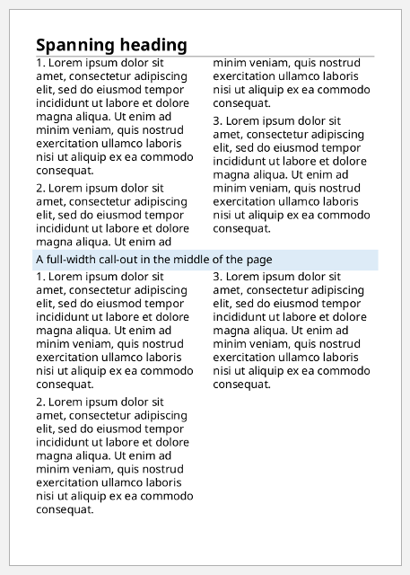
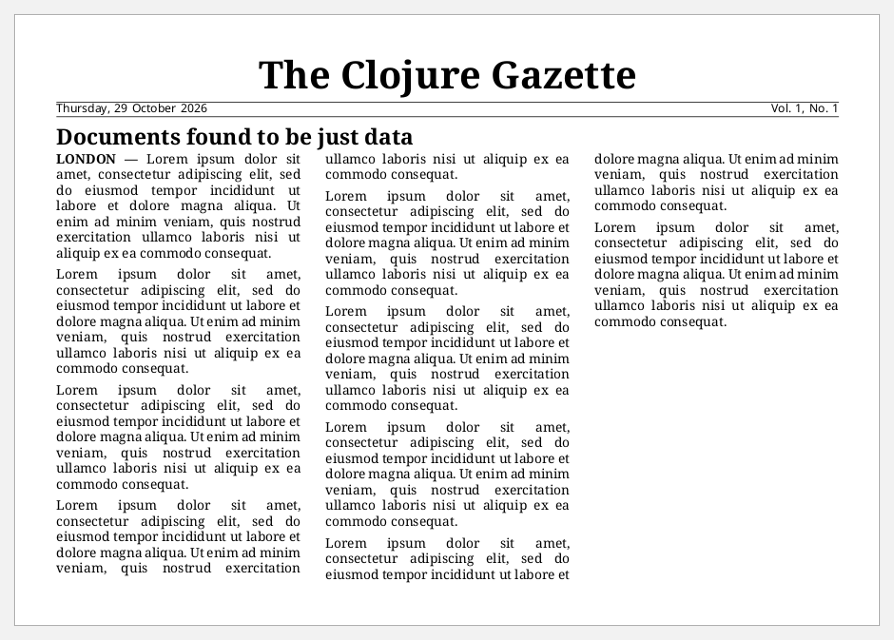

# Multi-column layout

Columns belong to the page, not the content. Set `:column-count` and
`:column-gap` on the `region-body`, and the flow fills each column in turn. A
block with `:span "all"` stretches across every column. Headings and banners
use it.

```clojure
(def lorem
  (str "Lorem ipsum dolor sit amet, consectetur adipiscing elit, sed do eiusmod tempor "
       "incididunt ut labore et dolore magna aliqua. Ut enim ad minim veniam, quis nostrud "
       "exercitation ullamco laboris nisi ut aliquip ex ea commodo consequat."))

(defn columns-document
  "A document whose region-body has n columns."
  [{:keys [n width height]} items]
  [:root
   {:layout-master-set {:xml/value [[:simple-page-master {:master-name "cols" :page-width width :page-height height
                                                          :margin "10mm"
                                                          :region-body {:column-count (str n) :column-gap "6mm"}}]]}
    :page-sequence     [{:master-reference "cols"
                         :flow {:flow-name "xsl-region-body" :xml/value (vec items)}}]}])

(defn paras [n]
  (for [i (range 1 (inc n))]
    [:block {:space-after "5pt" :xml/value [(str i ". ") lorem]}]))
```

## Two columns

```clojure example=columns-two
(columns-document {:n 2 :width "148mm" :height "210mm"} (paras 9))
```

[](examples/columns-two.pdf)

## Spanning every column

`:span "all"` gives a block the full width of the page. Content before it is
balanced across the columns before the span starts:

```clojure example=columns-span-all
(columns-document
 {:n 2 :width "148mm" :height "210mm"}
 (concat [[:block {:span "all" :font-size "18pt" :font-weight "bold" :space-after "6pt"
                   :border-bottom "thin solid black" :xml/value ["Spanning heading"]}]]
         (paras 3)
         [[:block {:span "all" :background-color "#DDEBF7" :padding "4pt" :space-before "4pt" :space-after "6pt"
                   :xml/value ["A full-width call-out in the middle of the page"]}]]
         (paras 3)))
```

[](examples/columns-span-all.pdf)

## A newspaper page

Three columns on a landscape page, with a masthead and a headline that span all
three:

```clojure example=columns-newspaper
(columns-document
 {:n 3 :width "210mm" :height "148mm"}
 (concat [[:block {:span "all" :text-align "center" :font-family "Times" :font-size "26pt" :font-weight "bold"
                   :xml/value ["The Clojure Gazette"]}]
          [:block {:span "all" :text-align-last "justify" :font-size "8pt" :space-after "6pt"
                   :border-before-style "solid" :border-before-width "0.5pt" :border-before-color "black"
                   :border-after-style "solid" :border-after-width "0.5pt" :border-after-color "black"
                   :xml/value ["Thursday, 29 October 2026" [:leader {:leader-pattern "space"}] "Vol. 1, No. 1"]}]
          [:block {:span "all" :font-family "Times" :font-size "15pt" :font-weight "bold" :space-after "6pt"
                   :xml/value ["Documents found to be just data"]}]]
         (for [i (range 9)]
           [:block {:font-family "Times" :font-size "9pt" :text-align "justify" :space-after "4pt"
                    :xml/value [(if (zero? i) [:inline {:font-weight "bold"} "LONDON — "] "") lorem]}])))
```

[](examples/columns-newspaper.pdf)

To break to the next column, use `:break-before "column"`. FOP notes that
footnotes have restrictions in multi-column documents.
