# The data model

XSL-FO is an XML vocabulary. clj-xml-fo writes it as plain Clojure data,
shaped by [sitoa](https://github.com/dunnage/sitoa)'s binding of Apache FOP's
`fop.xsd`. That binding has four rules:

1. An element is a vector `[tag content]`, and `content` is a map.
2. Attributes are keys in that map, with string values.
3. Children that the schema names, such as a table's body or a list's items, are
   keys as well.
4. Ordered children go under `:xml/value`. They are either elements or, in
   mixed content like a paragraph, strings and hiccup.

This page shows each rule with examples. The screenshots put flow content on
an A5 page, and clicking one opens the PDF.

## An element is `[tag content]`

The smallest element is an empty block. Its content map has nothing in it:

```clojure example=data-model-empty-block
[:block {}]
```

[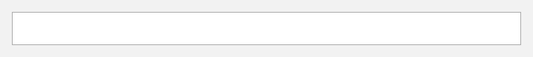](examples/data-model-empty-block.pdf)

Most elements carry attributes and something under `:xml/value`:

```clojure example=data-model-block
[:block {:font-size "16pt" :color "navy" :xml/value ["Hello, XSL-FO"]}]
```

[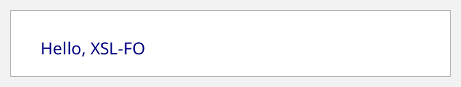](examples/data-model-block.pdf)

The tag is the XSL-FO element name without the `fo:` prefix. clj-xml-fo
puts every element in the XSL-FO namespace for you. `fo/xml-string` shows the
XML that the data stands for:

```clojure
(fo/xml-string [:block {:font-weight "bold" :xml/value ["Hi " [:inline {:font-style "italic"} "there"]]}])
;; => "<?xml version=\"1.0\" encoding=\"UTF-8\"?><fo:block xmlns:fo=\"http://www.w3.org/1999/XSL/Format\" font-weight=\"bold\">Hi <fo:inline font-style=\"italic\">there</fo:inline></fo:block>"
```

## Attributes are keys with string values

Every XSL-FO property is a keyword whose value is the attribute's text, exactly
as you would write it in XML, units and all:

```clojure example=data-model-attributes
[:block {:font-family   "Times"
         :font-size     "14pt"
         :line-height   "1.4"
         :text-align    "justify"
         :space-after   "6pt"
         :border-bottom "thin solid gray"
         :xml/value     ["Attributes are strings: \"14pt\", not 14. Lengths need a unit."]}]
```

[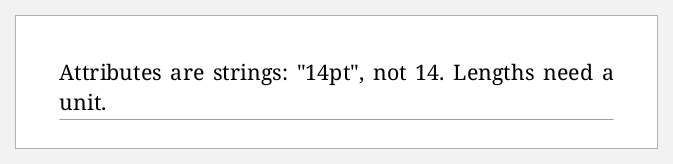](examples/data-model-attributes.pdf)

Dotted XSL-FO property components, such as `space-before.optimum` or
`keep-together.within-page`, are keywords too:

```clojure example=data-model-compound-attributes
[:block {:space-before.minimum      "4pt"
         :space-before.optimum      "8pt"
         :space-before.maximum      "12pt"
         :keep-together.within-page "always"
         :xml/value                 ["Compound properties keep their dots."]}]
```

[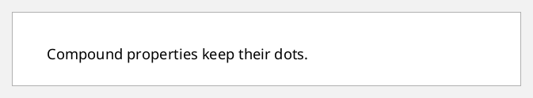](examples/data-model-compound-attributes.pdf)

## Children the schema names are keys

Some elements have a fixed set of children, which may be optional or
repeated: `root`, `simple-page-master`, `page-sequence`, `table`,
`table-row`, `list-block`, `list-item` and `footnote`. Each child is a key named
after its tag, and its value is the child's *content map*, with no tag
around it.

- A child that occurs **once** takes a map: `:flow {...}`, `:table-header {...}`.
- A child that **repeats** takes a vector of maps: `:page-sequence [{...}]`,
  `:table-column [{...} {...}]`, `:list-item [{...}]`.

```clojure example=data-model-keyed-children
[:table {:table-layout "fixed" :width "100%" :border "solid 0.5pt black"
         :table-column [{:column-width "40%"} {:column-width "60%"}]  ; repeats: a vector
         :table-header {:font-weight "bold"                           ; once: a map
                        :xml/value [[:table-row {:table-cell [{:padding "3pt" :xml/value [[:block {:xml/value ["Key"]}]]}
                                                              {:padding "3pt" :xml/value [[:block {:xml/value ["Value"]}]]}]}]]}
         :table-body   [{:xml/value [[:table-row {:table-cell [{:padding "3pt" :xml/value [[:block {:xml/value [":table-column"]}]]}
                                                               {:padding "3pt" :xml/value [[:block {:xml/value ["a vector of maps"]}]]}]}]
                                     [:table-row {:table-cell [{:padding "3pt" :xml/value [[:block {:xml/value [":table-header"]}]]}
                                                               {:padding "3pt" :xml/value [[:block {:xml/value ["one map"]}]]}]}]]}]}]
```

[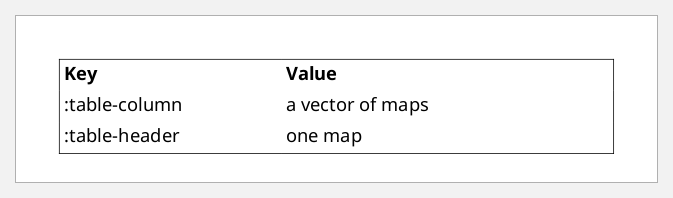](examples/data-model-keyed-children.pdf)

## Ordered children go under `:xml/value`

Elements that hold a *sequence* of block-level children put them in a vector
under `:xml/value`. Here each child is a whole element, `[tag content]`. These
elements include `flow`, `static-content`, `table-cell`, `table-body`,
`table-header`, `block-container`, `list-item-label`, `list-item-body` and
`footnote-body`.

```clojure example=data-model-element-content
[:block-container {:border "solid 1pt #2E75B6" :padding "6pt"
                   :xml/value [[:block {:font-weight "bold" :xml/value ["block-container"]}]
                               [:block {:xml/value ["Its :xml/value is a vector of elements,"]}]
                               [:block {:xml/value ["each one [tag content]."]}]]}]
```

[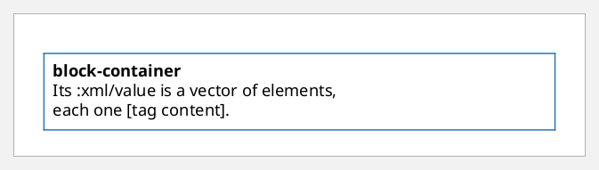](examples/data-model-element-content.pdf)

## Mixed content is hiccup

Paragraph-like elements mix text with inline elements: `block`, `inline`,
`basic-link`, `wrapper`, `leader`, `marker` and `title`. Their `:xml/value` is a
vector of strings and **hiccup**: `[tag attrs? & children]`, the same shape as
hiccup for HTML.

```clojure example=data-model-mixed-content
[:block {:font-size "12pt"
         :xml/value ["Text, "
                     [:inline {:font-weight "bold"} "bold"] ", "
                     [:inline {:font-style "italic" :color "darkred"} "italic and red"] ", "
                     [:inline {:font-family "Courier"} "monospace"] ", and a "
                     [:basic-link {:external-destination "url('https://clojure.org')" :color "blue"} "link"]
                     "."]}]
```

[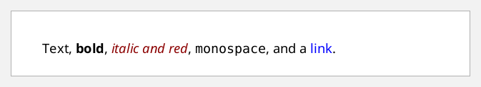](examples/data-model-mixed-content.pdf)

Inside hiccup, everything is hiccup, however deep it goes. A table nested in
a block writes its parts as positional children instead of keys:

```clojure example=data-model-hiccup-table
[:block {:xml/value ["A table inside mixed content:"
                     [:table {:table-layout "fixed" :width "60%" :border "solid 0.5pt gray" :space-before "4pt"}
                      [:table-column {:column-width "50%"}]
                      [:table-column {:column-width "50%"}]
                      [:table-body
                       [:table-row
                        [:table-cell {:padding "2pt"} [:block "hiccup"]]
                        [:table-cell {:padding "2pt"} [:block "all the way down"]]]]]]}]
```

[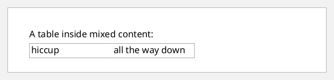](examples/data-model-hiccup-table.pdf)

So the same element is written two ways, depending on its parent:

```clojure
;; directly in a flow, table-cell, list-item-body...: [tag content-map]
[:block {:font-weight "bold" :xml/value ["Title"]}]

;; inside a block's :xml/value (mixed content): [tag attrs & children]
[:block {:font-weight "bold"} "Title"]
```

`:xml/value` of mixed content is always a *vector of children*, even when it
holds a single element:

```clojure invalid
;; Wrong. sitoa would read this as the block's own body and drop the inline.
[:block {:xml/value [:inline {:font-weight "bold"} "text"]}]
```

```clojure example=data-model-single-child
;; Right
[:block {:xml/value [[:inline {:font-weight "bold"} "text"]]}]
```

[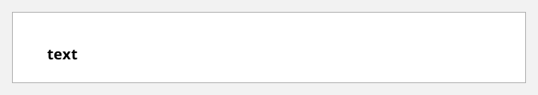](examples/data-model-single-child.pdf)

## A whole document

`:root` puts it all together. It names the page masters under
`:layout-master-set`, and gives the content as a vector of `:page-sequence`
maps, each with a `:flow`:

```clojure example=data-model-document
[:root
 {:layout-master-set {:xml/value [[:simple-page-master {:master-name "A5"
                                                        :page-width  "148mm"
                                                        :page-height "210mm"
                                                        :margin      "15mm"
                                                        :region-body {}}]]}
  :page-sequence     [{:master-reference "A5"
                       :flow {:flow-name "xsl-region-body"
                              :xml/value [[:block {:font-size "20pt" :space-after "6pt" :xml/value ["A whole document"]}]
                                          [:block {:xml/value ["root → page-sequence → flow → blocks."]}]]}}]}]
```

[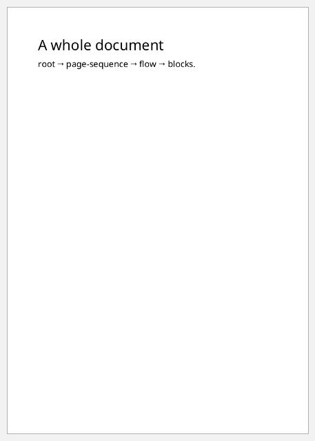](examples/data-model-document.pdf)

## Documents are values: build them with functions

Because it's all data, ordinary Clojure builds documents. Helper functions,
`map`, `for`, `assoc-in` and `update` all work:

```clojure
(defn para [& children]
  [:block {:space-after "4pt" :xml/value (vec children)}])

(defn a5-document [& items]
  [:root
   {:layout-master-set {:xml/value [[:simple-page-master {:master-name "A5" :page-width "148mm" :page-height "210mm"
                                                          :margin "15mm" :region-body {}}]]}
    :page-sequence     [{:master-reference "A5"
                         :flow {:flow-name "xsl-region-body" :xml/value (vec items)}}]}])
```

```clojure example=data-model-functions
(a5-document
 [:block {:font-size "16pt" :space-after "6pt" :xml/value ["Built with functions"]}]
 (para "Plain text, then " [:inline {:font-weight "bold"} "bold"] ".")
 (para "Three items from " [:inline {:font-family "Courier"} "map"] ":")
 [:block {:start-indent "12pt"
          :xml/value (vec (interpose [:inline {:color "gray"} " · "]
                                     (map #(str "item " %) (range 1 4))))}])
```

[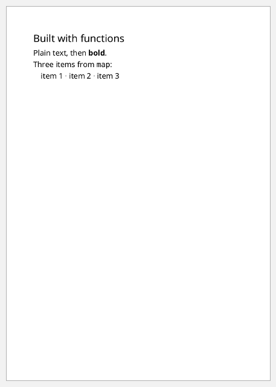](examples/data-model-functions.pdf)

Changing a document is a plain data update:

```clojure example=data-model-update
(-> (a5-document (para "Original text"))
    (assoc-in [1 :layout-master-set :xml/value 0 1 :page-width] "210mm")
    (update-in [1 :page-sequence 0 :flow :xml/value] conj (para "A paragraph added with update-in.")))
```

[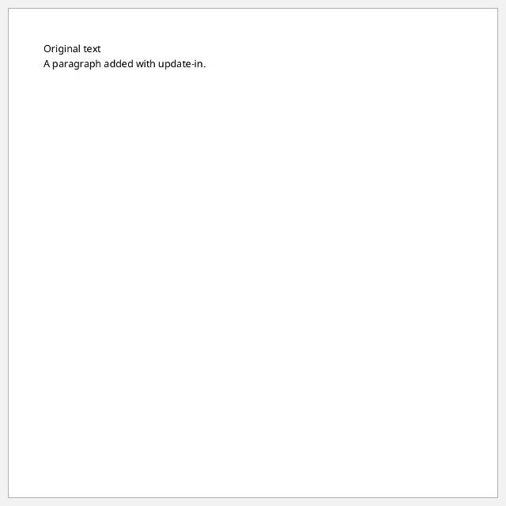](examples/data-model-update.pdf)

## Common mistakes

Each of these is caught by `fo/valid?`. Without validation, the encoder
would silently drop the unknown parts.

Hiccup-style children in *element* content, which needs `[tag content-map]`:

```clojure invalid
[:table-cell {:xml/value [[:block {} "hiccup belongs in mixed content"]]}]
```

A repeatable child given as one map instead of a vector of maps:

```clojure invalid
[:list-block {:list-item {:list-item-label {:xml/value [[:block {:xml/value ["•"]}]]}
                          :list-item-body  {:xml/value [[:block {:xml/value ["text"]}]]}}}]
```

Numbers, or lengths without units:

```clojure invalid
[:block {:font-size 12 :xml/value ["font-size must be \"12pt\""]}]
```

A misspelt attribute:

```clojure invalid
[:block {:font-wieght "bold" :xml/value ["The encoder would drop :font-wieght silently."]}]
```

One mistake validation *can't* see, because it is inside hiccup, is a
`[tag content-map]` element in mixed content. A helper that builds element
content, used inside a block's `:xml/value`, has its map read as attributes,
and FOP then rejects the document:

```clojure no-eval
(defn note [text] [:block {:color "gray" :xml/value [text]}])   ; element-content form

[:block {:xml/value ["Intro " (note "aside")]}]     ; wrong: inside mixed content it must be hiccup
[:flow {:flow-name "xsl-region-body"
        :xml/value [(note "aside")]}]               ; right: element content
[:block {:xml/value ["Intro " [:block {:color "gray"} "aside"]]}]   ; right: hiccup
```

See [element-reference.md](element-reference.md) for which rule applies to each
element.
