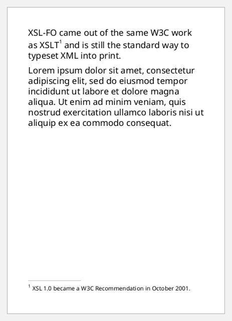
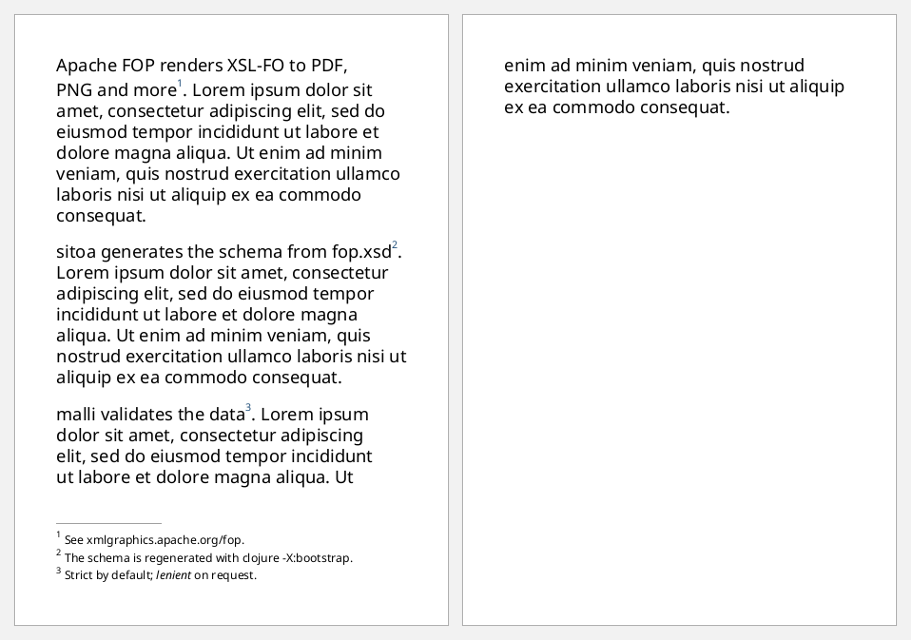

# Footnotes

A footnote has two parts:
- an **`inline`**, which is the reference mark in the text
- a **`footnote-body`**, which FOP places at the bottom of the same page

Inside a paragraph (mixed content) both are positional hiccup children:
`[:footnote [:inline ...] [:footnote-body ...]]`. The body holds blocks.

The line above the footnotes is optional. It's the static-content for the
special flow name `"xsl-footnote-separator"`.

```clojure
(def lorem
  (str "Lorem ipsum dolor sit amet, consectetur adipiscing elit, sed do eiusmod tempor "
       "incididunt ut labore et dolore magna aliqua. Ut enim ad minim veniam, quis nostrud "
       "exercitation ullamco laboris nisi ut aliquip ex ea commodo consequat."))

(defn a6-document
  "An A6 document with a footnote separator, around the given flow items."
  [items]
  [:root
   {:layout-master-set {:xml/value [[:simple-page-master {:master-name "a6" :page-width "105mm" :page-height "148mm"
                                                          :margin "10mm" :region-body {}}]]}
    :page-sequence     [{:master-reference "a6"
                         :static-content [{:flow-name "xsl-footnote-separator"
                                           :xml/value [[:block {:xml/value [[:leader {:leader-pattern "rule" :leader-length "30%"
                                                                                       :rule-thickness "0.5pt" :color "gray"}]]}]]}]
                         :flow {:flow-name "xsl-region-body" :xml/value (vec items)}}]}])
```

## A footnote

```clojure example=footnotes-basic
(a6-document
 [[:block {:space-after "6pt"
           :xml/value ["XSL-FO came out of the same W3C work as XSLT"
                       [:footnote
                        [:inline {:baseline-shift "super" :font-size "7pt"} "1"]
                        [:footnote-body
                         [:block {:font-size "8pt"}
                          [:inline {:baseline-shift "super" :font-size "6pt"} "1"]
                          " XSL 1.0 became a W3C Recommendation in October 2001."]]]
                       " and is still the standard way to typeset XML into print."]}]
  [:block {:xml/value [lorem]}]])
```

[](examples/footnotes-basic.pdf)

## Numbered footnotes from data

A small function builds the mark and the body together, so the two numbers
always agree:

```clojure example=footnotes-numbered
(defn footnote [n & note]
  [:footnote
   [:inline {:baseline-shift "super" :font-size "7pt" :color "#1F4E79"} (str n)]
   [:footnote-body
    (into [:block {:font-size "8pt" :space-after "2pt" :start-indent "0pt" :text-indent "0pt"}
           [:inline {:baseline-shift "super" :font-size "6pt"} (str n)] " "]
          note)]])

(def claims
  [["Apache FOP renders XSL-FO to PDF, PNG and more" "See xmlgraphics.apache.org/fop."]
   ["sitoa generates the schema from fop.xsd"        "The schema is regenerated with clojure -X:bootstrap."]
   ["malli validates the data"                       "Strict by default; " [:inline {:font-style "italic"} "lenient"] " on request."]])

(a6-document
 (vec (for [[n [claim & note]] (map-indexed (fn [i c] [(inc i) c]) claims)]
        [:block {:space-after "8pt" :xml/value [claim (apply footnote n note) ". " lorem]}])))
```

[](examples/footnotes-numbered.pdf)

The body's `:start-indent "0pt"` and `:text-indent "0pt"` stop a footnote
inheriting indents from the paragraph that cites it.

FOP keeps a footnote on the same page as its reference mark. It notes that
footnotes in multi-column documents have restrictions.
