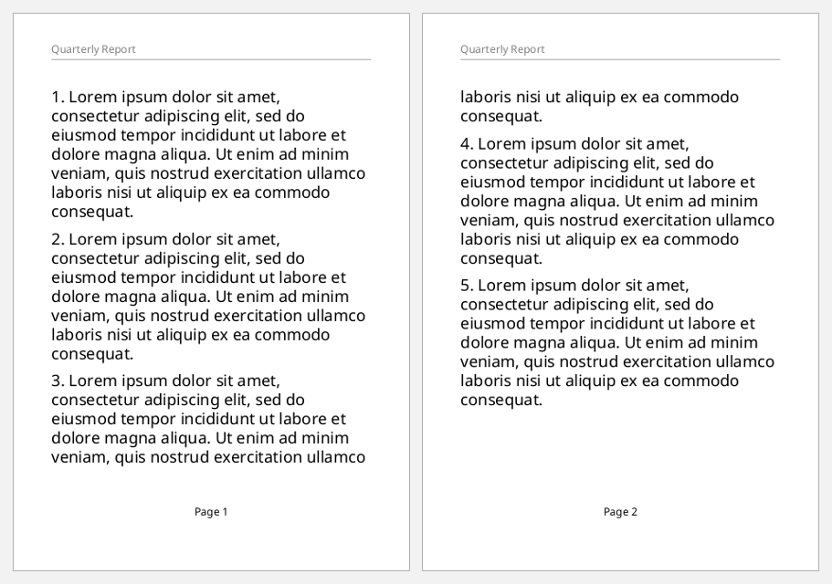
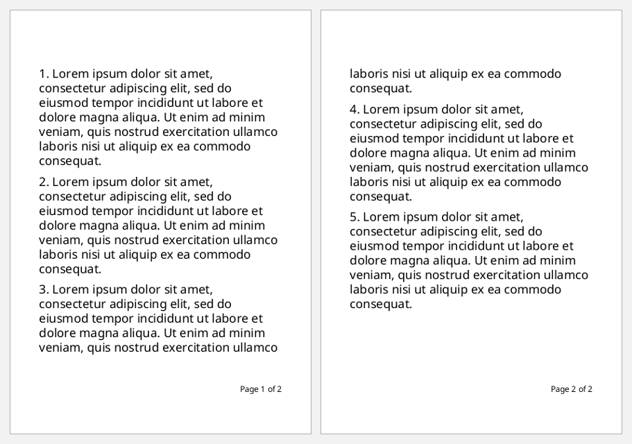
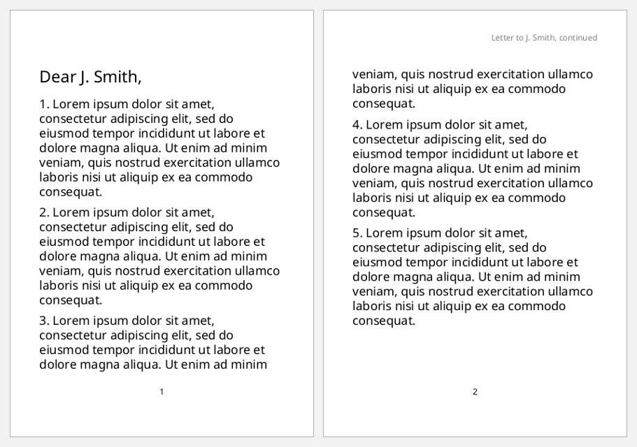
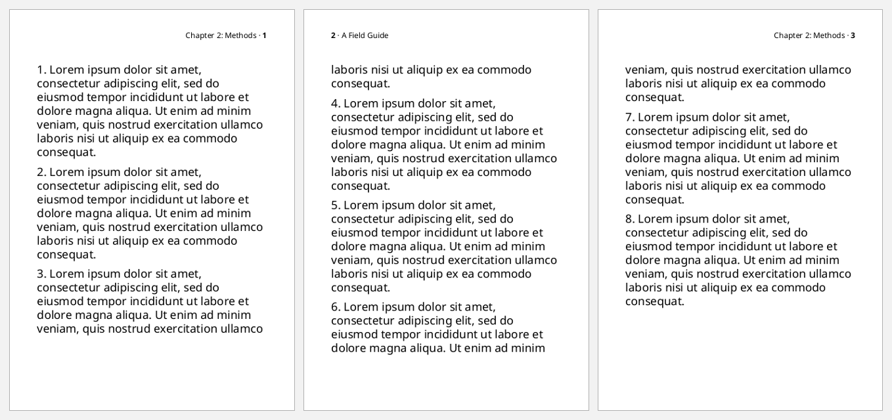
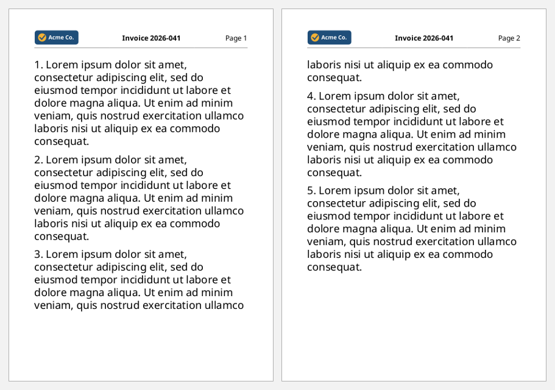

# Headers and footers

Headers and footers are `static-content`. Each one fills an outer region of
the page master (`region-before`, `region-after`) and repeats on every page
of its page-sequence. The flow fills `region-body`.

On this page:
- `:static-content` is a vector of maps, one per region. Each map names its
  region with `:flow-name`, and its `:xml/value` holds blocks.
- `[:page-number]` prints the current page's number, inside mixed content.
- The region-body's top and bottom margins leave room for the header and
  footer.

```clojure
(def lorem
  (str "Lorem ipsum dolor sit amet, consectetur adipiscing elit, sed do eiusmod tempor "
       "incididunt ut labore et dolore magna aliqua. Ut enim ad minim veniam, quis nostrud "
       "exercitation ullamco laboris nisi ut aliquip ex ea commodo consequat."))

(defn paragraphs [n]
  (vec (for [i (range 1 (inc n))]
         [:block {:space-after "6pt" :xml/value [(str i ". " lorem)]}])))

(defn page-master
  "An A6 master with 9mm header and footer regions."
  [name & {:as more}]
  [:simple-page-master (merge {:master-name   name
                               :page-width    "105mm"
                               :page-height   "148mm"
                               :margin        "8mm 10mm"
                               :region-body   {:margin-top "12mm" :margin-bottom "12mm"}
                               :region-before {:extent "9mm"}
                               :region-after  {:extent "9mm"}}
                              more)])
```

## A header and a page-numbered footer

```clojure example=hf-basic
[:root
 {:layout-master-set {:xml/value [(page-master "page")]}
  :page-sequence
  [{:master-reference "page"
    :static-content   [{:flow-name "xsl-region-before"
                        :xml/value [[:block {:font-size "8pt" :color "gray" :padding-bottom "2pt"
                                             :border-bottom "thin solid gray"
                                             :xml/value ["Quarterly Report"]}]]}
                       {:flow-name "xsl-region-after"
                        :xml/value [[:block {:font-size "8pt" :text-align "center"
                                             :xml/value ["Page " [:page-number]]}]]}]
    :flow             {:flow-name "xsl-region-body" :xml/value (paragraphs 5)}}]}]
```

[](examples/hf-basic.pdf)

## Page N of M

XSL-FO 1.0 gets the last page number by citing an empty block at the end of
the flow. `[:page-number-citation {:ref-id "end"}]` prints the page number of
the block whose `:id` is `"end"`:

```clojure example=hf-page-x-of-y
[:root
 {:layout-master-set {:xml/value [(page-master "page")]}
  :page-sequence
  [{:master-reference "page"
    :static-content   [{:flow-name "xsl-region-after"
                        :xml/value [[:block {:font-size "8pt" :text-align "end"
                                             :xml/value ["Page " [:page-number] " of " [:page-number-citation {:ref-id "end"}]]}]]}]
    :flow             {:flow-name "xsl-region-body"
                       :xml/value (conj (paragraphs 5) [:block {:id "end"}])}}]}]
```

[](examples/hf-page-x-of-y.pdf)

XSL 1.1's `fo:page-number-citation-last` isn't in `fop.xsd`, which describes
XSL-FO 1.0, so the empty-block citation is the way to do it.

## Left and right on one line

A leader with `:leader-pattern "space"` stretches to fill the line when the
block's last line is justified. That pushes the text after it to the far
edge:

```clojure example=hf-left-right
[:root
 {:layout-master-set {:xml/value [(page-master "page")]}
  :page-sequence
  [{:master-reference "page"
    :static-content   [{:flow-name "xsl-region-before"
                        :xml/value [[:block {:font-size "8pt" :text-align-last "justify" :border-bottom "thin solid black"
                                             :xml/value [[:inline {:font-weight "bold"} "Acme Co."]
                                                         [:leader {:leader-pattern "space"}]
                                                         "29 October 2026"]}]]}
                       {:flow-name "xsl-region-after"
                        :xml/value [[:block {:font-size "8pt" :text-align-last "justify" :color "gray"
                                             :xml/value ["Confidential"
                                                         [:leader {:leader-pattern "space"}]
                                                         "Page " [:page-number] " of " [:page-number-citation {:ref-id "end"}]]}]]}]
    :flow             {:flow-name "xsl-region-body"
                       :xml/value (conj (paragraphs 5) [:block {:id "end"}])}}]}]
```

[](examples/hf-left-right.pdf)

## A different header on the first page

Give the first and the other pages' header regions different `:region-name`s,
and choose the master per page with a `page-sequence-master`. Here
`static-content` fills only `"rest-before"`, so page 1 has no header:

```clojure example=hf-first-page-different
[:root
 {:layout-master-set
  {:xml/value [(page-master "first" :region-before {:extent "9mm" :region-name "first-before"})
               (page-master "rest"  :region-before {:extent "9mm" :region-name "rest-before"})
               [:page-sequence-master
                {:master-name "letter"
                 :xml/value   [[:repeatable-page-master-alternatives
                                {:conditional-page-master-reference
                                 [{:master-reference "first" :page-position "first"}
                                  {:master-reference "rest"  :page-position "rest"}]}]]}]]}
  :page-sequence
  [{:master-reference "letter"
    :static-content   [{:flow-name "rest-before"
                        :xml/value [[:block {:font-size "8pt" :color "gray" :text-align "end"
                                             :xml/value ["Letter to J. Smith, continued"]}]]}
                       {:flow-name "xsl-region-after"
                        :xml/value [[:block {:font-size "8pt" :text-align "center" :xml/value [[:page-number]]}]]}]
    :flow             {:flow-name "xsl-region-body"
                       :xml/value (into [[:block {:font-size "16pt" :space-after "10pt" :xml/value ["Dear J. Smith,"]}]]
                                        (paragraphs 5))}}]}]
```

[](examples/hf-first-page-different.pdf)

## Odd and even pages

Book-style headers put the page number on the outer edge: right on odd pages,
left on even pages. Use two region names, one per master:

```clojure example=hf-odd-even
[:root
 {:layout-master-set
  {:xml/value [(page-master "odd"  :region-before {:extent "9mm" :region-name "odd-before"})
               (page-master "even" :region-before {:extent "9mm" :region-name "even-before"})
               [:page-sequence-master
                {:master-name "book"
                 :xml/value   [[:repeatable-page-master-alternatives
                                {:conditional-page-master-reference
                                 [{:master-reference "odd"  :odd-or-even "odd"}
                                  {:master-reference "even" :odd-or-even "even"}]}]]}]]}
  :page-sequence
  [{:master-reference "book"
    :static-content   [{:flow-name "odd-before"
                        :xml/value [[:block {:font-size "8pt" :text-align "end"
                                             :xml/value ["Chapter 2: Methods · " [:inline {:font-weight "bold"} [:page-number]]]}]]}
                       {:flow-name "even-before"
                        :xml/value [[:block {:font-size "8pt" :text-align "start"
                                             :xml/value [[:inline {:font-weight "bold"} [:page-number]] " · A Field Guide"]}]]}]
    :flow             {:flow-name "xsl-region-body" :xml/value (paragraphs 8)}}]}]
```

[](examples/hf-odd-even.pdf)

## A header laid out with a table

For a logo, a title and a page number side by side, use a fixed-layout table
in the header. The logo is an SVG file, resolved against the FOP factory's
base URI (see [images-and-svg.md](images-and-svg.md)):

```clojure example=hf-table-header
(defn header-cell [align & children]
  {:display-align "center" :xml/value [[:block {:text-align align :xml/value (vec children)}]]})

[:root
 {:layout-master-set {:xml/value [(page-master "page" :region-before {:extent "10mm"})]}
  :page-sequence
  [{:master-reference "page"
    :static-content   [{:flow-name "xsl-region-before"
                        :xml/value [[:table {:table-layout "fixed" :width "100%" :font-size "8pt"
                                             :border-bottom "thin solid gray"
                                             :table-column [{:column-width "35%"} {:column-width "40%"} {:column-width "25%"}]
                                             :table-body   [{:xml/value [[:table-row {:table-cell [(header-cell "start" [:external-graphic {:src "url('images/logo.svg')" :content-height "6mm"}])
                                                                                                   (header-cell "center" [:inline {:font-weight "bold"} "Invoice 2026-041"])
                                                                                                   (header-cell "end" "Page " [:page-number])]}]]}]}]]}]
    :flow             {:flow-name "xsl-region-body" :xml/value (paragraphs 5)}}]}]
```

[](examples/hf-table-header.pdf)
