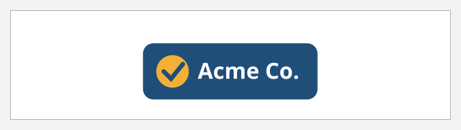
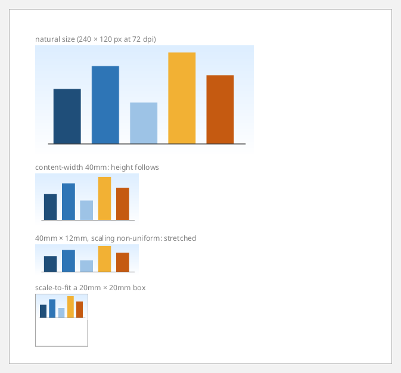
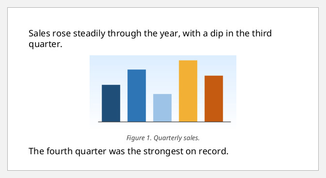
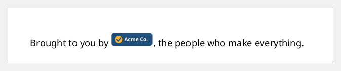
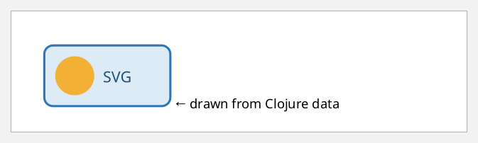
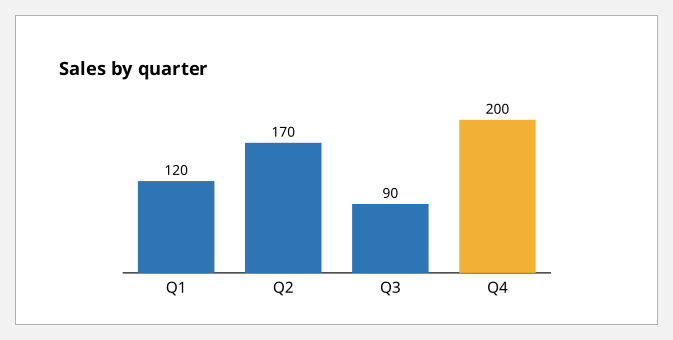

# Images and SVG

There are two ways to put graphics on a page:

- **`external-graphic`** loads an image file: SVG, PNG, JPEG, GIF, TIFF or
  EPS. Its `:src` is `url('...')`. Relative paths resolve against the FOP
  factory's base URI. These docs use the `doc/` directory as the base, so
  `url('images/logo.svg')` is `doc/images/logo.svg`. Pass your own factory with
  `:fop-factory` (see [rendering.md](rendering.md)).
- **`instream-foreign-object`** embeds the graphic in the document itself.
  FOP renders SVG this way. It only appears in mixed content, as hiccup, and
  the SVG root declares its namespace with an `:xmlns` attribute.

Both are inline-level, so they sit inside a block's `:xml/value`.

## An SVG file

```clojure example=images-svg-file
[:block {:text-align "center"
         :xml/value [[:external-graphic {:src "url('images/logo.svg')" :content-width "60mm"}]]}]
```

[](examples/images-svg-file.pdf)

## Sizing

- `:content-width` and `:content-height` set the image's size. Give one of
  them and the other follows the aspect ratio.
- `:scaling "non-uniform"` lets both be set freely, so the image stretches.
- `"scale-to-fit"` fits the image into the box set by `:width` and `:height`.
- A raster image without resolution metadata is read at 72 dpi.

```clojure example=images-sizing
(defn labelled [label graphic]
  [:block {:space-after "6pt"
           :xml/value [[:block {:font-size "8pt" :color "gray"} label] graphic]}])

[(labelled "natural size (240 × 120 px at 72 dpi)"
           [:external-graphic {:src "url('images/chart.png')"}])
 (labelled "content-width 40mm: height follows"
           [:external-graphic {:src "url('images/chart.png')" :content-width "40mm"}])
 (labelled "40mm × 12mm, scaling non-uniform: stretched"
           [:external-graphic {:src "url('images/chart.png')" :content-width "40mm" :content-height "12mm" :scaling "non-uniform"}])
 (labelled "scale-to-fit a 20mm × 20mm box"
           [:external-graphic {:src "url('images/chart.png')" :width "20mm" :height "20mm"
                               :content-width "scale-to-fit" :content-height "scale-to-fit"
                               :border "solid 0.5pt gray"}])]
```

[](examples/images-sizing.pdf)

## A figure with a caption

```clojure example=images-figure
(defn figure [src width caption]
  [:block {:text-align "center" :space-before "6pt" :space-after "6pt" :keep-together.within-page "always"
           :xml/value [[:external-graphic {:src (str "url('" src "')") :content-width width}]
                       [:block {:font-size "9pt" :font-style "italic" :color "#404040" :space-before "3pt"} caption]]}])

[[:block {:xml/value ["Sales rose steadily through the year, with a dip in the third quarter."]}]
 (figure "images/chart.png" "70mm" "Figure 1. Quarterly sales.")
 [:block {:xml/value ["The fourth quarter was the strongest on record."]}]]
```

[](examples/images-figure.pdf)

## Images inside a line of text

An inline image sits on the baseline like a large letter. Size it in `em`s to
match the text:

```clojure example=images-inline-text
[:block {:font-size "12pt" :line-height "1.6"
         :xml/value ["Brought to you by "
                     [:external-graphic {:src "url('images/logo.svg')" :content-height "1.5em"}]
                     ", the people who make everything."]}]
```

[](examples/images-inline-text.pdf)

## Inline SVG

Put SVG in a document with `instream-foreign-object`. It is written as hiccup,
so its attributes can be numbers or strings. The `:xmlns` attribute puts the
`svg` element and its children in the SVG namespace:

```clojure example=images-inline-svg
[:block {:xml/value
         [[:instream-foreign-object {}
           [:svg {:xmlns "http://www.w3.org/2000/svg" :width "120pt" :height "60pt" :viewBox "0 0 120 60"}
            [:rect {:x 2 :y 2 :width 116 :height 56 :rx 8 :fill "#DDEBF7" :stroke "#2E75B6" :stroke-width 2}]
            [:circle {:cx 30 :cy 30 :r 18 :fill "#F2B134"}]
            [:text {:x 56 :y 36 :font-family "Helvetica" :font-size 14 :fill "#1F4E79"} "SVG"]]]
          "  ← drawn from Clojure data"]}]
```

[](examples/images-inline-svg.pdf)

## Charts from data

SVG is just more hiccup, so a chart is a function of its data:

```clojure example=images-svg-chart
(def sales [["Q1" 120] ["Q2" 170] ["Q3" 90] ["Q4" 200]])

(defn bar-chart [data]
  (let [bar 50, gap 20, base 120
        scale (/ 100.0 (apply max (map second data)))]
    (into [:svg {:xmlns "http://www.w3.org/2000/svg" :width "300pt" :height "140pt" :viewBox "0 0 300 140"}
           [:line {:x1 10 :y1 base :x2 290 :y2 base :stroke "#404040"}]]
          (for [[i [label v]] (map-indexed vector data)
                :let [x (+ 20 (* i (+ bar gap)))
                      h (* v scale)]]
            [:g
             [:rect {:x x :y (- base h) :width bar :height h :fill (if (= v (apply max (map second data))) "#F2B134" "#2E75B6")}]
             [:text {:x (+ x (/ bar 2)) :y (+ base 13) :font-family "Helvetica" :font-size 10 :text-anchor "middle"} label]
             [:text {:x (+ x (/ bar 2)) :y (- base h 4) :font-family "Helvetica" :font-size 9 :text-anchor "middle"} (str v)]]))))

[[:block {:font-weight "bold" :space-after "4pt" :xml/value ["Sales by quarter"]}]
 [:block {:text-align "center" :xml/value [[:instream-foreign-object {} (bar-chart sales)]]}]]
```

[](examples/images-svg-chart.pdf)

FOP renders SVG with Apache Batik. Batik is a dependency of FOP, so there's
nothing more to install. Other foreign namespaces, such as MathML, need FOP
extensions.
