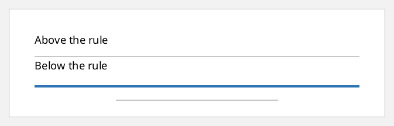
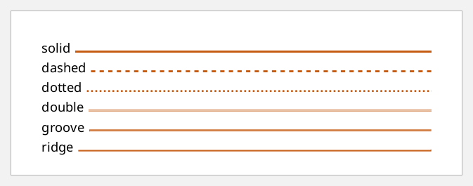
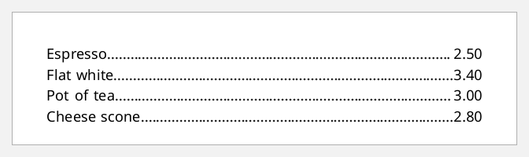
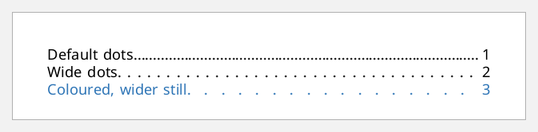
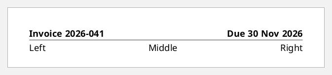

# Leaders and rules

A **leader** is an inline that fills space: a rule, a row of dots, or blank
space.
- `:leader-pattern` picks what it fills with: `"rule"`, `"dots"`, `"space"` or
  `"use-content"`.
- `:leader-length` sets its size. It is either fixed, or a range FOP stretches
  within.

Leaders give you horizontal rules, dot leaders and right-aligned text.

## Horizontal rules

A rule leader with `:leader-length "100%"` in a block of its own is a horizontal
line. `:rule-thickness` and `:color` style it:

```clojure example=leaders-rule
[[:block {:xml/value ["Above the rule"]}]
 [:block {:xml/value [[:leader {:leader-pattern "rule" :leader-length "100%" :rule-thickness "0.5pt" :color "gray"}]]}]
 [:block {:xml/value ["Below the rule"]}]
 [:block {:space-before "6pt"
          :xml/value [[:leader {:leader-pattern "rule" :leader-length "100%" :rule-thickness "3pt" :color "#2E75B6"}]]}]
 [:block {:text-align "center"
          :xml/value [[:leader {:leader-pattern "rule" :leader-length "50%" :rule-thickness "1pt"}]]}]]
```

[](examples/leaders-rule.pdf)

## Rule styles

`:rule-style` takes the border styles:

```clojure example=leaders-rule-styles
(vec (for [style ["solid" "dashed" "dotted" "double" "groove" "ridge"]]
       [:block {:space-after "4pt" :text-align-last "justify"
                :xml/value [(str style " ")
                            [:leader {:leader-pattern "rule" :rule-style style :rule-thickness "2pt" :color "#C55A11"}]]}]))
```

[](examples/leaders-rule-styles.pdf)

## Dot leaders

A dot leader between two pieces of text, with `:text-align-last "justify"` on
the block, stretches to push the second piece to the right edge. It's the
classic menu or table-of-contents line:

```clojure example=leaders-dots
(def menu [["Espresso" "2.50"] ["Flat white" "3.40"] ["Pot of tea" "3.00"] ["Cheese scone" "2.80"]])

(vec (for [[item price] menu]
       [:block {:text-align-last "justify" :space-after "3pt"
                :xml/value [item [:leader {:leader-pattern "dots"}] price]}]))
```

[](examples/leaders-dots.pdf)

`:leader-pattern-width` spaces out the dots:

```clojure example=leaders-dot-spacing
[[:block {:text-align-last "justify" :xml/value ["Default dots" [:leader {:leader-pattern "dots"}] "1"]}]
 [:block {:text-align-last "justify" :xml/value ["Wide dots" [:leader {:leader-pattern "dots" :leader-pattern-width "8pt"}] "2"]}]
 [:block {:text-align-last "justify" :color "#2E75B6"
          :xml/value ["Coloured, wider still" [:leader {:leader-pattern "dots" :leader-pattern-width "14pt"}] "3"]}]]
```

[](examples/leaders-dot-spacing.pdf)

## Left and right on one line

A `"space"` leader is invisible. It pushes what follows to the end of the line,
which is how headers put text on both sides (see
[headers-and-footers.md](headers-and-footers.md)):

```clojure example=leaders-space
[[:block {:text-align-last "justify" :font-weight "bold" :border-bottom "thin solid black"
          :xml/value ["Invoice 2026-041" [:leader {:leader-pattern "space"}] "Due 30 Nov 2026"]}]
 [:block {:text-align-last "justify" :space-before "4pt"
          :xml/value ["Left" [:leader {:leader-pattern "space"}] "Middle" [:leader {:leader-pattern "space"}] "Right"]}]]
```

[](examples/leaders-space.pdf)

## Fixed-length lines: forms and signatures

A rule with a fixed `:leader-length` makes a fill-in line:

```clojure example=leaders-signature
[[:block {:space-after "14pt"
          :xml/value ["Name: " [:leader {:leader-pattern "rule" :leader-length "70mm" :rule-thickness "0.5pt"}]]}]
 [:block {:xml/value ["Signature: " [:leader {:leader-pattern "rule" :leader-length "50mm" :rule-thickness "0.5pt"}]
                      "   Date: " [:leader {:leader-pattern "rule" :leader-length "25mm" :rule-thickness "0.5pt"}]]}]]
```

[](examples/leaders-signature.pdf)
