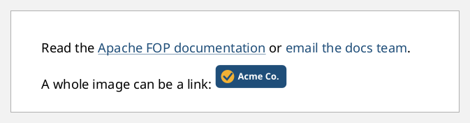
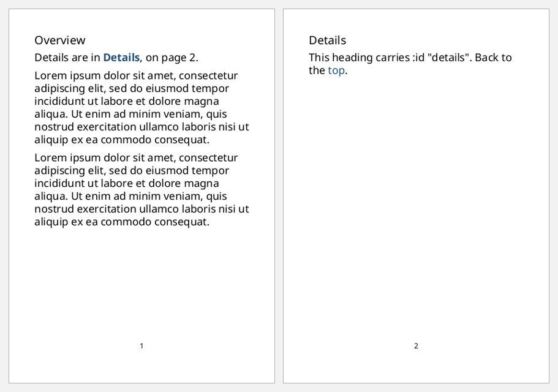
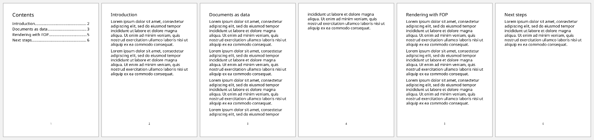

# Links, cross-references and tables of contents

Three pieces work together:
- **`:id`** names any block-level or inline element, such as a heading.
- **`[:basic-link ...]`** makes a clickable link. `:external-destination` points
  at a URL and `:internal-destination` at an `:id`.
- **`[:page-number-citation {:ref-id "..."}]`** prints the page an `:id` lands on.
  FOP fills it in after layout, so it works for forward references too.

```clojure
(def lorem
  (str "Lorem ipsum dolor sit amet, consectetur adipiscing elit, sed do eiusmod tempor "
       "incididunt ut labore et dolore magna aliqua. Ut enim ad minim veniam, quis nostrud "
       "exercitation ullamco laboris nisi ut aliquip ex ea commodo consequat."))

(defn a6-document
  "An A6 document with a page-number footer around the given flow items."
  [items]
  [:root
   {:layout-master-set {:xml/value [[:simple-page-master {:master-name "a6" :page-width "105mm" :page-height "148mm"
                                                          :margin "10mm" :region-body {:margin-bottom "8mm"}
                                                          :region-after {:extent "6mm"}}]]}
    :page-sequence     [{:master-reference "a6"
                         :static-content [{:flow-name "xsl-region-after"
                                           :xml/value [[:block {:font-size "8pt" :text-align "center" :xml/value [[:page-number]]}]]}]
                         :flow {:flow-name "xsl-region-body" :xml/value (vec items)}}]}])
```

## External links

`:external-destination` takes `url('...')`. A link has no styling of its own,
so give it a colour or an underline:

```clojure example=links-external
[[:block {:space-after "6pt"
          :xml/value ["Read the "
                      [:basic-link {:external-destination "url('https://xmlgraphics.apache.org/fop/')"
                                    :color "#1F4E79" :text-decoration "underline"}
                       "Apache FOP documentation"]
                      " or "
                      [:basic-link {:external-destination "url('mailto:docs@example.com')" :color "#1F4E79"}
                       "email the docs team"]
                      "."]}]
 [:block {:xml/value ["A whole image can be a link: "
                      [:basic-link {:external-destination "url('https://github.com/dunnage/clj-xml-fo')"}
                       [:external-graphic {:src "url('images/logo.svg')" :content-height "8mm"}]]]}]]
```

[](examples/links-external.pdf)

## Internal links and "see page N"

```clojure example=links-internal
(a6-document
 [[:block {:font-size "13pt" :space-after "4pt" :xml/value ["Overview"]}]
  [:block {:space-after "6pt"
           :xml/value ["Details are in "
                       [:basic-link {:internal-destination "details" :color "#1F4E79" :font-weight "bold"} "Details"]
                       ", on page " [:page-number-citation {:ref-id "details"}] "."]}]
  [:block {:space-after "6pt" :xml/value [lorem]}]
  [:block {:space-after "6pt" :xml/value [lorem]}]
  [:block {:id "details" :break-before "page" :font-size "13pt" :space-after "4pt" :xml/value ["Details"]}]
  [:block {:xml/value ["This heading carries :id \"details\". Back to the "
                       [:basic-link {:internal-destination "top" :color "#1F4E79"} "top"] "."]}]
  [:block {:id "top" :xml/value []}]])
```

[](examples/links-internal.pdf)

## A table of contents from data

Each TOC line pairs a link to the chapter's `:id` with a dotted leader and the
page number. The leader stretches to fill the line because
`:text-align-last "justify"` stretches it (see [leaders.md](leaders.md)).

```clojure example=links-toc
(def chapters
  [{:id "intro"  :title "Introduction"       :paragraphs 2}
   {:id "data"   :title "Documents as data"  :paragraphs 4}
   {:id "render" :title "Rendering with FOP" :paragraphs 3}
   {:id "next"   :title "Next steps"         :paragraphs 1}])

(defn toc-line [{:keys [id title]}]
  [:block {:text-align-last "justify" :space-after "3pt"
           :xml/value [[:basic-link {:internal-destination id} title]
                       [:leader {:leader-pattern "dots"}]
                       [:page-number-citation {:ref-id id}]]}])

(defn chapter [{:keys [id title paragraphs]}]
  (into [[:block {:id id :break-before "page" :font-size "14pt" :space-after "6pt" :xml/value [title]}]]
        (repeat paragraphs [:block {:space-after "6pt" :xml/value [lorem]}])))

(a6-document
 (concat [[:block {:font-size "16pt" :space-after "10pt" :xml/value ["Contents"]}]]
         (map toc-line chapters)
         (mapcat chapter chapters)))
```

[](examples/links-toc.pdf)

In the PDF, every TOC entry is clickable. Each `:id` must be unique across the
document, and FOP reports a duplicate.
