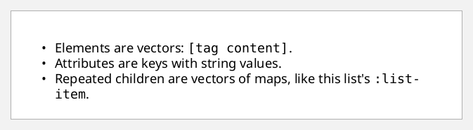
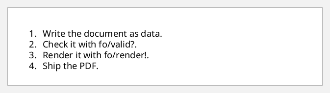
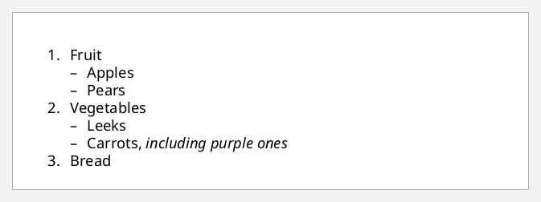
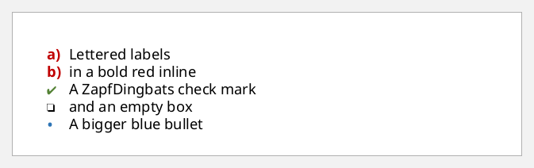
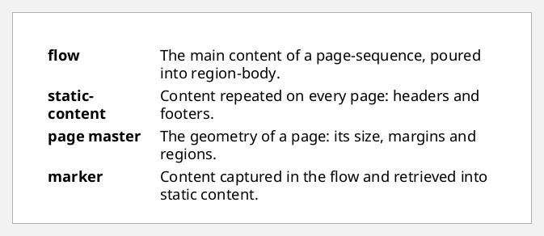
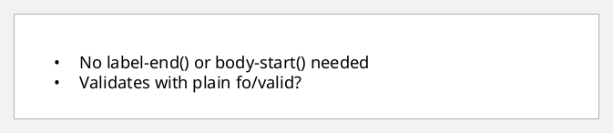
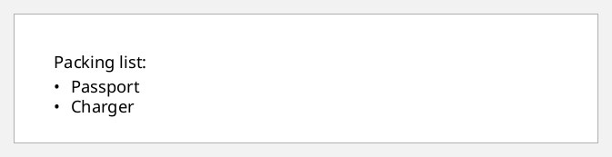

# Lists

A list is a `list-block` of `list-item`s, and each item has a **label**
(the bullet or number) and a **body**.

- `list-item` is a repeatable child of `list-block`, so it takes a vector of
  content maps.
- `list-item-label` and `list-item-body` are keyed children of each item.
  Their `:xml/value` holds blocks.
- The list sets the geometry. `:provisional-distance-between-starts` is the
  distance from the label's start to the body's start, and
  `:provisional-label-separation` is the gap after the label.
- The label ends at `"label-end()"` and the body starts at `"body-start()"`.
  These are XSL-FO functions computed from those two lengths.

`fop.xsd` has no grammar for FO functions such as `label-end()`, so the examples
that use them validate with `{:lenient? true}`. [A strict
alternative](#without-the-functions) is further down.

```clojure
(defn item
  "A list item: a label string and body content (mixed)."
  [label & body]
  {:list-item-label {:end-indent "label-end()"    :xml/value [[:block {:xml/value [label]}]]}
   :list-item-body  {:start-indent "body-start()" :xml/value [[:block {:xml/value (vec body)}]]}})
```

## A bulleted list

```clojure example=lists-bullets lenient
[:list-block {:provisional-distance-between-starts "12pt"
              :provisional-label-separation        "4pt"
              :list-item [(item "•" "Elements are vectors: " [:inline {:font-family "Courier"} "[tag content]"] ".")
                          (item "•" "Attributes are keys with string values.")
                          (item "•" "Repeated children are vectors of maps, like this list's "
                                [:inline {:font-family "Courier"} ":list-item"] ".")]}]
```

[](examples/lists-bullets.pdf)

## A numbered list, built from data

The items come from a vector of strings. Note `vec`: a repeatable child takes a
vector. A lazy seq also works, but it is encoded as a stream (see
[streaming.md](streaming.md)).

```clojure example=lists-numbered lenient
(def steps ["Write the document as data."
            "Check it with fo/valid?."
            "Render it with fo/render!."
            "Ship the PDF."])

[:list-block {:provisional-distance-between-starts "18pt"
              :list-item (vec (map-indexed (fn [i s] (item (str (inc i) ".") s)) steps))}]
```

[](examples/lists-numbered.pdf)

## Nested lists

A list-item-body's `:xml/value` is element content. It can hold blocks, tables
or another `list-block`:

```clojure example=lists-nested lenient
(defn item-with [label text sub-list]
  {:list-item-label {:end-indent "label-end()" :xml/value [[:block {:xml/value [label]}]]}
   :list-item-body  {:start-indent "body-start()"
                     :xml/value [[:block {:xml/value [text]}]
                                 sub-list]}})

[:list-block {:provisional-distance-between-starts "18pt" :provisional-label-separation "4pt"
              :list-item [(item-with "1." "Fruit"
                                     [:list-block {:provisional-distance-between-starts "14pt" :provisional-label-separation "4pt"
                                                   :list-item [(item "–" "Apples") (item "–" "Pears")]}])
                          (item-with "2." "Vegetables"
                                     [:list-block {:provisional-distance-between-starts "14pt" :provisional-label-separation "4pt"
                                                   :list-item [(item "–" "Leeks")
                                                               (item "–" "Carrots, "
                                                                     [:inline {:font-style "italic"} "including purple ones"])]}])
                          (item "3." "Bread")]}]
```

[](examples/lists-nested.pdf)

## Styled labels

The label is ordinary content, so it can be anything: letters, roman numerals,
coloured bullets, or a checkbox from the ZapfDingbats font:

```clojure example=lists-label-styles lenient
(defn label-item [label-inline text]
  {:list-item-label {:end-indent "label-end()" :xml/value [[:block {:xml/value [label-inline]}]]}
   :list-item-body  {:start-indent "body-start()" :xml/value [[:block {:xml/value [text]}]]}})

[:list-block {:provisional-distance-between-starts "18pt" :space-after "6pt"
              :list-item [(label-item [:inline {:color "#C00000" :font-weight "bold"} "a)"] "Lettered labels")
                          (label-item [:inline {:color "#C00000" :font-weight "bold"} "b)"] "in a bold red inline")
                          (label-item [:inline {:font-family "ZapfDingbats" :color "#548235"} "✔"] "A ZapfDingbats check mark")
                          (label-item [:inline {:font-family "ZapfDingbats"} "❏"] "and an empty box")
                          (label-item [:inline {:color "#2E75B6" :font-size "14pt"} "•"] "A bigger blue bullet")]}]
```

[](examples/lists-label-styles.pdf)

## Definition lists

A wide label column turns a list into a glossary:

```clojure example=lists-definitions lenient
(defn term [t & definition]
  {:space-after "4pt"
   :list-item-label {:end-indent "label-end()" :xml/value [[:block {:font-weight "bold" :xml/value [t]}]]}
   :list-item-body  {:start-indent "body-start()" :xml/value [[:block {:xml/value (vec definition)}]]}})

[:list-block {:provisional-distance-between-starts "32mm" :provisional-label-separation "4mm"
              :list-item [(term "flow" "The main content of a page-sequence, poured into region-body.")
                          (term "static-content" "Content repeated on every page: headers and footers.")
                          (term "page master" "The geometry of a page: its size, margins and regions.")
                          (term "marker" "Content captured in the flow and retrieved into static content.")]}]
```

[](examples/lists-definitions.pdf)

## Without the functions

To stay strictly valid, give the body a plain `:start-indent` equal to the
distance between starts. Leave the label's end indent off; a short label
fits in the space before the body anyway:

```clojure example=lists-strict
(defn strict-item [label text]
  {:list-item-label {:xml/value [[:block {:xml/value [label]}]]}
   :list-item-body  {:start-indent "18pt" :xml/value [[:block {:xml/value [text]}]]}})

[:list-block {:provisional-distance-between-starts "18pt"
              :list-item [(strict-item "•" "No label-end() or body-start() needed")
                          (strict-item "•" "Validates with plain fo/valid?")]}]
```

[](examples/lists-strict.pdf)

## Lists inside a paragraph

Inside mixed content everything is hiccup, lists included. The label and the
body are positional children of each `list-item`:

```clojure example=lists-hiccup lenient
[:block {:xml/value ["Packing list:"
                     [:list-block {:provisional-distance-between-starts "12pt" :space-before "3pt"}
                      [:list-item
                       [:list-item-label {:end-indent "label-end()"} [:block "•"]]
                       [:list-item-body {:start-indent "body-start()"} [:block "Passport"]]]
                      [:list-item
                       [:list-item-label {:end-indent "label-end()"} [:block "•"]]
                       [:list-item-body {:start-indent "body-start()"} [:block "Charger"]]]]]}]
```

[](examples/lists-hiccup.pdf)
