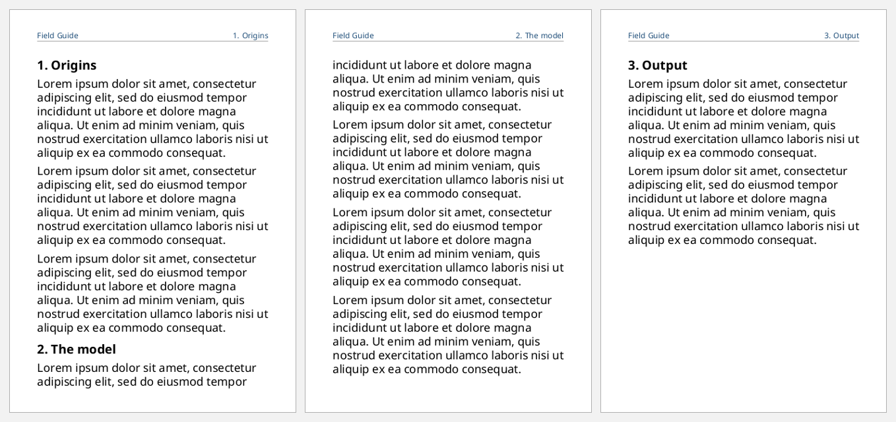
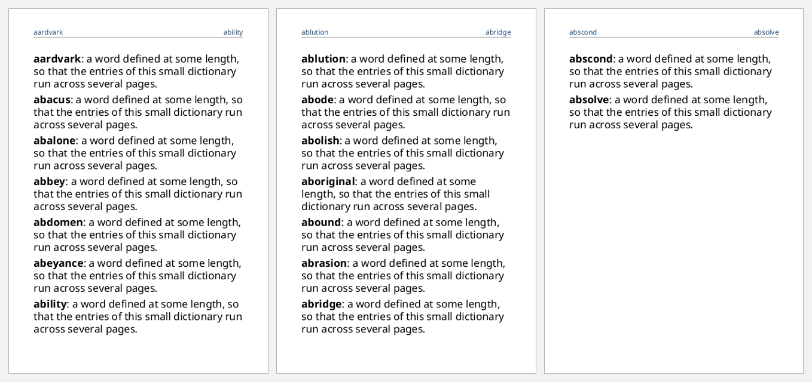

# Markers: running headers

A **marker** captures some content in the flow, and a **retrieve-marker** in
static-content copies it onto the page. This is how a header shows "the
chapter on this page" or a dictionary shows "first and last word on this page".

- `[:marker {:marker-class-name "chapter"} ...]` goes at the *start* of a block
  in the flow, before any other content. Its content is mixed (hiccup).
- `[:retrieve-marker {:retrieve-class-name "chapter" :retrieve-position ...}]`
  goes in static-content.
- `:retrieve-position` chooses which marker on the page wins:
  `"first-starting-within-page"`, `"first-including-carryover"` (the default),
  `"last-starting-within-page"` or `"last-ending-within-page"`.

```clojure
(def lorem
  (str "Lorem ipsum dolor sit amet, consectetur adipiscing elit, sed do eiusmod tempor "
       "incididunt ut labore et dolore magna aliqua. Ut enim ad minim veniam, quis nostrud "
       "exercitation ullamco laboris nisi ut aliquip ex ea commodo consequat."))

(defn a6-with-header
  "An A6 document whose header holds the given mixed content."
  [header items]
  [:root
   {:layout-master-set {:xml/value [[:simple-page-master {:master-name "a6" :page-width "105mm" :page-height "148mm"
                                                          :margin "8mm 10mm" :region-body {:margin-top "10mm"}
                                                          :region-before {:extent "8mm"}}]]}
    :page-sequence     [{:master-reference "a6"
                         :static-content [{:flow-name "xsl-region-before"
                                           :xml/value [[:block {:font-size "8pt" :color "#1F4E79" :border-bottom "thin solid gray"
                                                                :text-align-last "justify" :xml/value header}]]}]
                         :flow {:flow-name "xsl-region-body" :xml/value (vec items)}}]}])
```

## The current chapter in the header

Each chapter heading starts with a marker. On every page, the header retrieves
the chapter in effect at the top of that page, including one carried over from
an earlier page:

```clojure example=markers-running-header
(def chapters [["1. Origins" 3] ["2. The model" 4] ["3. Output" 2]])

(defn chapter [[title n]]
  (into [[:block {:font-size "13pt" :font-weight "bold" :space-before "8pt" :space-after "4pt"
                  :keep-with-next "always"
                  :xml/value [[:marker {:marker-class-name "chapter"} title] title]}]]
        (repeat n [:block {:space-after "5pt" :xml/value [lorem]}])))

(a6-with-header
 ["Field Guide" [:leader {:leader-pattern "space"}]
  [:retrieve-marker {:retrieve-class-name "chapter" :retrieve-position "first-including-carryover"}]]
 (mapcat chapter chapters))
```

[](examples/markers-running-header.pdf)

## Dictionary-style headers

Two retrieve-markers, one for the first entry that starts on the page and one
for the last entry that ends on it, give a dictionary's "aardvark – axolotl"
header:

```clojure example=markers-dictionary
(def entries
  ["aardvark" "abacus" "abalone" "abbey" "abdomen" "abeyance" "ability" "ablution"
   "abode" "abolish" "aboriginal" "abound" "abrasion" "abridge" "abscond" "absolve"])

(defn entry [word]
  [:block {:space-after "4pt"
           :xml/value [[:marker {:marker-class-name "word"} word]
                       [:inline {:font-weight "bold"} word]
                       ": a word defined at some length, so that the entries of this small dictionary run across several pages."]}])

(a6-with-header
 [[:retrieve-marker {:retrieve-class-name "word" :retrieve-position "first-starting-within-page"}]
  [:leader {:leader-pattern "space"}]
  [:retrieve-marker {:retrieve-class-name "word" :retrieve-position "last-ending-within-page"}]]
 (map entry entries))
```

[](examples/markers-dictionary.pdf)
