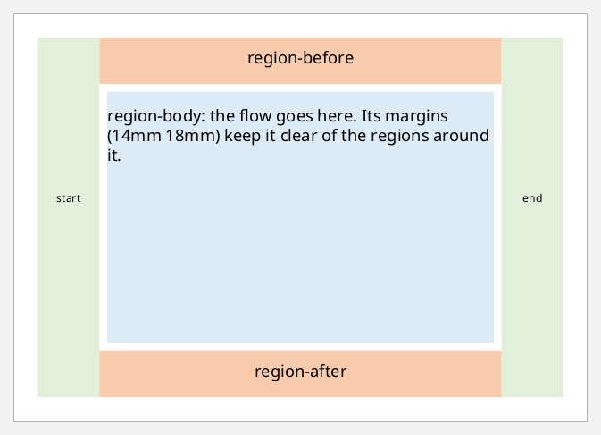
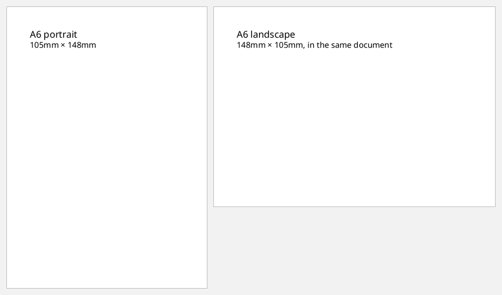
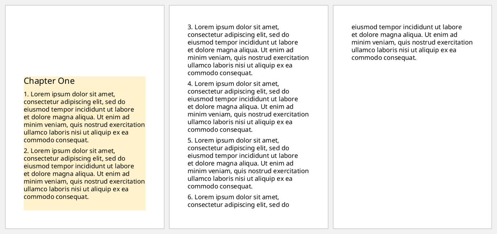
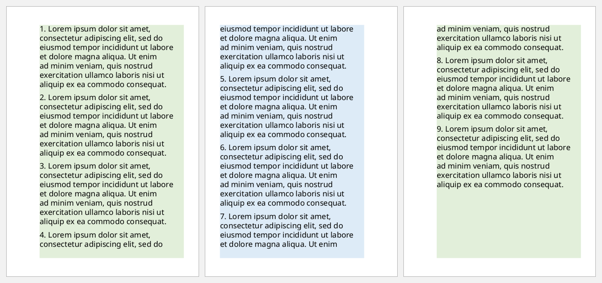
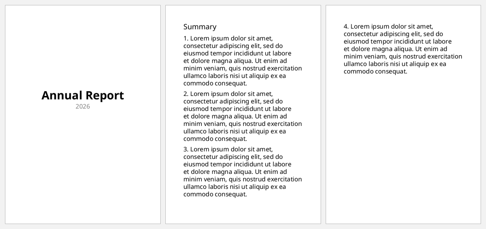
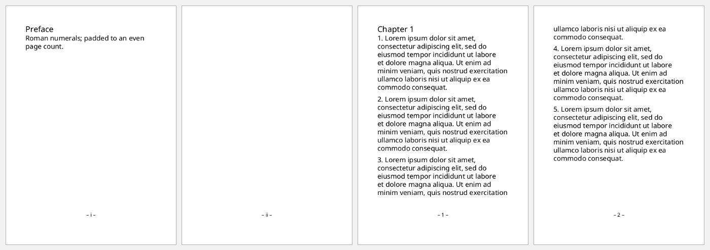

# Page layout

A document's pages come from **page masters** in the `:layout-master-set`. Each
`:page-sequence` names the master its pages use, and its `:flow` pours content
onto them.

- **`simple-page-master`** is one page geometry: its size, its margins, and up
  to five regions.
- **`page-sequence-master`** picks between simple masters page by page: first
  page, odd and even pages, blank pages.

The examples on this page share a few helpers:

```clojure
(def page-sizes
  {"A4"     {:page-width "210mm" :page-height "297mm"}
   "A5"     {:page-width "148mm" :page-height "210mm"}
   "A6"     {:page-width "105mm" :page-height "148mm"}
   "Letter" {:page-width "8.5in" :page-height "11in"}})

(defn master
  "A simple-page-master with 12mm margins and a region-body; more overrides."
  [name size & {:as more}]
  [:simple-page-master (merge {:master-name name :margin "12mm" :region-body {}}
                              (page-sizes size)
                              more)])

(def lorem
  (str "Lorem ipsum dolor sit amet, consectetur adipiscing elit, sed do eiusmod tempor "
       "incididunt ut labore et dolore magna aliqua. Ut enim ad minim veniam, quis nostrud "
       "exercitation ullamco laboris nisi ut aliquip ex ea commodo consequat."))

(defn paragraphs [n]
  (vec (for [i (range 1 (inc n))]
         [:block {:space-after "6pt" :xml/value [(str i ". " lorem)]}])))
```

## The five regions

A simple page master has a **region-body** for the flow. Around it can sit
**region-before** (the header), **region-after** (the footer),
**region-start** (left) and **region-end** (right). The outer regions are
sized by `:extent`. The body is sized by its own margins, which must leave
room for the regions around it. Here each region is coloured and labelled by
its own `static-content`:

```clojure example=layout-regions
[:root
 {:layout-master-set
  {:xml/value [[:simple-page-master
                {:master-name   "regions"
                 :page-width    "148mm"
                 :page-height   "105mm"
                 :margin        "6mm"
                 :region-body   {:margin "14mm 18mm" :background-color "#DDEBF7"}
                 :region-before {:extent "12mm" :background-color "#F8CBAD"}
                 :region-after  {:extent "12mm" :background-color "#F8CBAD"}
                 :region-start  {:extent "16mm" :background-color "#E2EFDA"}
                 :region-end    {:extent "16mm" :background-color "#E2EFDA"}}]]}
  :page-sequence
  [{:master-reference "regions"
    :static-content   [{:flow-name "xsl-region-before" :xml/value [[:block {:text-align "center" :padding-top "3mm" :xml/value ["region-before"]}]]}
                       {:flow-name "xsl-region-after"  :xml/value [[:block {:text-align "center" :padding-top "3mm" :xml/value ["region-after"]}]]}
                       {:flow-name "xsl-region-start"  :xml/value [[:block {:padding-top "40mm" :font-size "8pt" :text-align "center" :xml/value ["start"]}]]}
                       {:flow-name "xsl-region-end"    :xml/value [[:block {:padding-top "40mm" :font-size "8pt" :text-align "center" :xml/value ["end"]}]]}]
    :flow             {:flow-name "xsl-region-body"
                       :xml/value [[:block {:padding "4mm" :xml/value ["region-body: the flow goes here. Its margins (14mm 18mm) keep it clear of the regions around it."]}]]}}]}]
```

[](examples/layout-regions.pdf)

Some things to note:

- The page `:margin` is the outer white frame. The regions sit inside it.
- `static-content` is a repeatable child of `page-sequence`, so it takes a
  vector of maps. Each one names the region it fills with `:flow-name`.
- The default region names are `xsl-region-body`, `xsl-region-before`,
  `xsl-region-after`, `xsl-region-start` and `xsl-region-end`. Give a region a
  `:region-name` to address it by another name (see
  [headers-and-footers.md](headers-and-footers.md)).

## Page sizes and orientation

Sizes are just two lengths, and landscape swaps them. Different page-sequences
can use different masters, so one document can mix orientations:

```clojure
(defn landscape [[tag m]]
  [tag (assoc m :page-width (:page-height m) :page-height (:page-width m))])
```

```clojure example=layout-orientation
[:root
 {:layout-master-set {:xml/value [(master "portrait" "A6")
                                  (landscape (master "landscape" "A6"))]}
  :page-sequence     [{:master-reference "portrait"
                       :flow {:flow-name "xsl-region-body"
                              :xml/value [[:block {:font-size "14pt" :xml/value ["A6 portrait"]}]
                                          [:block {:xml/value ["105mm × 148mm"]}]]}}
                      {:master-reference "landscape"
                       :flow {:flow-name "xsl-region-body"
                              :xml/value [[:block {:font-size "14pt" :xml/value ["A6 landscape"]}]
                                          [:block {:xml/value ["148mm × 105mm, in the same document"]}]]}}]}]
```

[](examples/layout-orientation.pdf)

## A different first page

A `page-sequence-master` with `repeatable-page-master-alternatives` chooses a
master for each page by condition. Here the first page of the chapter has a
tall top margin, with a shaded body to make it visible, and the other pages
use the plain master:

```clojure example=layout-first-page
[:root
 {:layout-master-set
  {:xml/value [(master "first" "A6" :region-body {:margin-top "35mm" :background-color "#FFF2CC"})
               (master "rest" "A6")
               [:page-sequence-master
                {:master-name "chapter"
                 :xml/value   [[:repeatable-page-master-alternatives
                                {:conditional-page-master-reference
                                 [{:master-reference "first" :page-position "first"}
                                  {:master-reference "rest"  :page-position "rest"}]}]]}]]}
  :page-sequence [{:master-reference "chapter"     ; a page-sequence-master, not a page
                   :flow {:flow-name "xsl-region-body"
                          :xml/value (into [[:block {:font-size "16pt" :space-after "8pt" :xml/value ["Chapter One"]}]]
                                           (paragraphs 6))}}]}]
```

[](examples/layout-first-page.pdf)

`:page-position` can be `"first"`, `"last"`, `"rest"` or `"any"`. FOP doesn't
support `"only"`. `:conditional-page-master-reference` repeats, so it takes a
vector. The first alternative whose conditions all match wins.

## Odd and even pages

`:odd-or-even` mirrors pages for binding. Here the shaded body shifts towards
the outer edge, with a wider inner margin on each side of the spine:

```clojure example=layout-odd-even
[:root
 {:layout-master-set
  {:xml/value [(master "odd"  "A6" :margin "10mm 8mm 10mm 18mm" :region-body {:background-color "#E2EFDA"})
               (master "even" "A6" :margin "10mm 18mm 10mm 8mm" :region-body {:background-color "#DDEBF7"})
               [:page-sequence-master
                {:master-name "book"
                 :xml/value   [[:repeatable-page-master-alternatives
                                {:conditional-page-master-reference
                                 [{:master-reference "odd"  :odd-or-even "odd"}
                                  {:master-reference "even" :odd-or-even "even"}]}]]}]]}
  :page-sequence [{:master-reference "book"
                   :flow {:flow-name "xsl-region-body" :xml/value (paragraphs 9)}}]}]
```

[](examples/layout-odd-even.pdf)

## A title page, then body pages

`single-page-master-reference` uses a master once. A
`repeatable-page-master-reference` after it covers every following page. A
`:break-before "page"` ends the title page:

```clojure example=layout-title-page
[:root
 {:layout-master-set
  {:xml/value [(master "title" "A6" :region-body {:margin-top "45mm"})
               (master "body" "A6")
               [:page-sequence-master
                {:master-name "report"
                 :xml/value   [[:single-page-master-reference {:master-reference "title"}]
                               [:repeatable-page-master-reference {:master-reference "body"}]]}]]}
  :page-sequence [{:master-reference "report"
                   :flow {:flow-name "xsl-region-body"
                          :xml/value (into [[:block {:font-size "22pt" :font-weight "bold" :text-align "center" :xml/value ["Annual Report"]}]
                                            [:block {:text-align "center" :color "gray" :xml/value ["2026"]}]
                                            [:block {:break-before "page" :font-size "14pt" :space-after "6pt" :xml/value ["Summary"]}]]
                                           (paragraphs 4))}}]}]
```

[](examples/layout-title-page.pdf)

## Page numbering per sequence

Each page-sequence numbers its own pages:

- **`:initial-page-number`** restarts the count.
- **`:format`** picks the number style: `"1"`, `"i"`, `"I"`, `"a"` or `"A"`.
- **`:force-page-count`** pads a sequence, for example to an even page count, so
  the next one starts on a right-hand page.

The footer prints the number with `[:page-number]`:

```clojure
(defn numbered [seq-map]
  (assoc seq-map :static-content
         [{:flow-name "xsl-region-after"
           :xml/value [[:block {:text-align "center" :font-size "9pt" :xml/value ["– " [:page-number] " –"]}]]}]))

(def numbered-master (master "numbered" "A6" :region-body {:margin-bottom "10mm"} :region-after {:extent "8mm"}))
```

```clojure example=layout-page-numbering
[:root
 {:layout-master-set {:xml/value [numbered-master]}
  :page-sequence
  [(numbered {:master-reference "numbered" :format "i" :force-page-count "even"
              :flow {:flow-name "xsl-region-body"
                     :xml/value [[:block {:font-size "14pt" :xml/value ["Preface"]}]
                                 [:block {:xml/value ["Roman numerals; padded to an even page count."]}]]}})
   (numbered {:master-reference "numbered" :initial-page-number "1"
              :flow {:flow-name "xsl-region-body"
                     :xml/value (into [[:block {:font-size "14pt" :xml/value ["Chapter 1"]}]] (paragraphs 5))}})]}]
```

[](examples/layout-page-numbering.pdf)

The preface is one page, so `:force-page-count "even"` adds a blank page ii.
Chapter 1 then restarts at 1.
