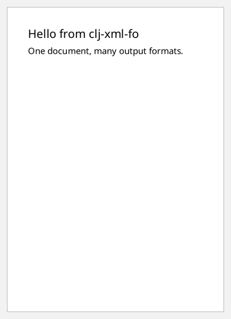

# Rendering

There are three ways out of the library:

| Function | Produces |
|---|---|
| `fo/render!` | Apache FOP output: PDF, PNG, PostScript, plain text and more |
| `fo/xml-string`, `fo/write-xml!` | XSL-FO XML text, for inspection or another FO processor |
| `fo/encode!` | SAX events into any `org.xml.sax.ContentHandler` |

All three go through sitoa's unparser. `render!` hands the events straight to
FOP, with no XML text in between.

```clojure
(require '[clojure.java.io :as io]
         '[clojure.string :as str])
(import '(java.io ByteArrayOutputStream)
        '(org.apache.fop.apps FopFactory))
```

The examples render this document:

```clojure example=rendering-sample
(def doc
  [:root
   {:layout-master-set {:xml/value [[:simple-page-master {:master-name "a6" :page-width "105mm" :page-height "148mm"
                                                          :margin "10mm" :region-body {}}]]}
    :page-sequence     [{:master-reference "a6"
                         :flow {:flow-name "xsl-region-body"
                                :xml/value [[:block {:font-size "16pt" :space-after "6pt" :xml/value ["Hello from clj-xml-fo"]}]
                                            [:block {:xml/value ["One document, many output formats."]}]]}}]}])
```

[](examples/rendering-sample.pdf)

## `render!`

`render!` writes to an `OutputStream`, which it leaves open, or to anything
`clojure.java.io/output-stream` accepts: a `File` or a path, which it opens and
closes. It returns the page counts:

```clojure
(fo/render! doc (ByteArrayOutputStream.))
;; => {:page-count 1, :page-sequences [{:id "", :page-count 1}]}
```

```clojure no-eval
(fo/render! doc "hello.pdf")
(fo/render! doc (io/file "out" "hello.pdf") {:validate? true})
```

## Output formats

`:mime` picks FOP's renderer. The default is `"application/pdf"`.

```clojure
(defn render-bytes [doc mime]
  (let [out (ByteArrayOutputStream.)]
    (fo/render! doc out {:mime mime})
    (.toByteArray out)))

(String. (render-bytes doc "application/pdf") 0 5 "US-ASCII")
;; => "%PDF-"
(String. (render-bytes doc "image/png") 1 3 "US-ASCII")
;; => "PNG"
(String. (render-bytes doc "application/postscript") 0 4 "US-ASCII")
;; => "%!PS"
(String. (render-bytes doc "application/rtf") 0 5 "US-ASCII")
;; => "{\\rtf"
(str/includes? (String. (render-bytes doc "text/plain") "UTF-8") "Hello from clj-xml-fo")
;; => true
```

| `:mime` | Output |
|---|---|
| `"application/pdf"` | PDF (the default) |
| `"application/postscript"` | PostScript |
| `"image/png"`, `"image/tiff"` | page images. A PNG stream gets the first page; see below for more |
| `"application/rtf"` | RTF |
| `"text/plain"` | text, laid out on a character grid |
| `"application/X-fop-areatree"` | FOP's area tree as XML: every page, area and word with its position |

Bitmap output defaults to 72 dpi. For a sharper PNG, and for one file per page,
use an FOUserAgent (see [below](#per-render-settings-the-fouseragent)): set
`.setTargetResolution`, and give it `.setOutputFile`. FOP then writes page 2
onwards next to that file.

## The FOP factory: base URI and configuration

Relative URIs in a document, such as an image's `url('images/logo.svg')`,
resolve against the factory's base URI. By default `render!` shares one factory
whose base is the working directory. Pass your own with `:fop-factory`:

```clojure
(def factory (FopFactory/newInstance (.toURI (io/file "doc/"))))

(:page-count
 (fo/render! [:root {:layout-master-set {:xml/value [[:simple-page-master {:master-name "p" :region-body {}}]]}
                     :page-sequence [{:master-reference "p"
                                      :flow {:flow-name "xsl-region-body"
                                             :xml/value [[:block {:xml/value [[:external-graphic {:src "url('images/logo.svg')"}]]}]]}}]}]
             (ByteArrayOutputStream.)
             {:fop-factory factory}))
;; => 1
```

A factory is expensive to create and safe to share, so make one and reuse it.

### Fonts

The base-14 fonts cover Western European text. For anything else, and for your
own typefaces, configure fonts in an `fop.xconf` file and build the factory
from it:

```xml
<fop version="1.0">
  <renderers>
    <renderer mime="application/pdf">
      <fonts>
        <!-- every font in a directory -->
        <directory recursive="true">/usr/share/fonts/truetype</directory>
        <!-- or one font, under a family name of your choice -->
        <font kerning="yes" embed-url="fonts/NotoSans-Regular.ttf">
          <font-triplet name="Noto Sans" style="normal" weight="normal"/>
        </font>
      </fonts>
    </renderer>
  </renderers>
</fop>
```

```clojure no-eval
(def factory (FopFactory/newInstance (io/file "fop.xconf")))

(fo/render! [:root ... [:block {:font-family "Noto Sans" :xml/value ["Grüße, 你好, Привет"]}] ...]
            "fonts.pdf"
            {:fop-factory factory})
```

## Per-render settings: the FOUserAgent

An `FOUserAgent` carries per-render settings, such as document metadata,
accessibility (tagged PDF) and bitmap resolution. Create a new one for each
render with `.newFOUserAgent` and pass it as `:user-agent`. It overrides
`:fop-factory`.

```clojure
(def ua (doto (.newFOUserAgent factory)
          (.setTitle "Hello report")
          (.setAuthor "Acme Co.")
          (.setAccessibility true)))

(let [out (ByteArrayOutputStream.)]
  (fo/render! doc out {:user-agent ua})
  (str/includes? (String. (.toByteArray out) "ISO-8859-1") "Hello report"))
;; => true
```

## FO XML

`xml-string` returns the XSL-FO as a string. `write-xml!` streams it to a
`Writer`, `OutputStream`, `File` or path. Both take `:validate?` and
`:lenient?`, plus `:indent?`:

```clojure
(fo/xml-string [:block {:xml/value ["Hi"]}])
;; => "<?xml version=\"1.0\" encoding=\"UTF-8\"?><fo:block xmlns:fo=\"http://www.w3.org/1999/XSL/Format\">Hi</fo:block>"

(second (str/split-lines (fo/xml-string doc {:indent? true})))
;; => "    <fo:layout-master-set>"
```

`(fo/xml-string doc {:indent? true})` in full:

```xml
<?xml version="1.0" encoding="UTF-8"?><fo:root xmlns:fo="http://www.w3.org/1999/XSL/Format">
    <fo:layout-master-set>
        <fo:simple-page-master margin="10mm" master-name="a6" page-height="148mm" page-width="105mm">
            <fo:region-body/>
        </fo:simple-page-master>
    </fo:layout-master-set>
    <fo:page-sequence master-reference="a6">
        <fo:flow flow-name="xsl-region-body">
            <fo:block font-size="16pt" space-after="6pt">Hello from clj-xml-fo</fo:block>
            <fo:block>One document, many output formats.</fo:block>
        </fo:flow>
    </fo:page-sequence>
</fo:root>
```

```clojure no-eval
(fo/write-xml! doc "hello.fo")
```

Indenting adds whitespace between elements. That's harmless in element
content, but it can change the spacing of mixed content, so leave `:indent?`
off for XML that will be rendered.

## Any SAX handler

`encode!` emits the document as SAX events, `startDocument` through
`endDocument`, into any `ContentHandler`. Elements are in the XSL-FO namespace
with the prefix `fo`. Use it to feed another FO processor, an XSLT
`TransformerHandler`, or your own code:

```clojure
(let [tags (atom [])]
  (fo/encode! doc (proxy [org.xml.sax.helpers.DefaultHandler] []
                    (startElement [_uri local _qname _attrs] (swap! tags conj local))))
  @tags)
;; => ["root" "layout-master-set" "simple-page-master" "region-body" "page-sequence" "flow" "block" "block"]
```

Every function here also accepts documents that hold streams; see
[streaming.md](streaming.md).
