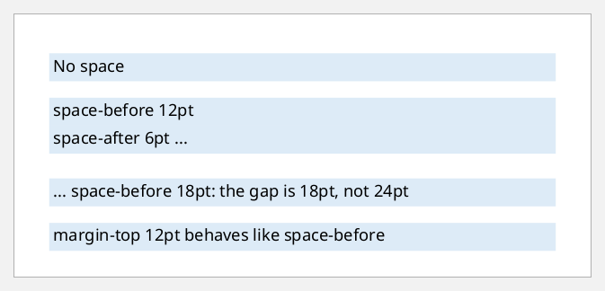
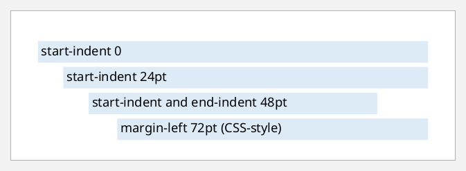
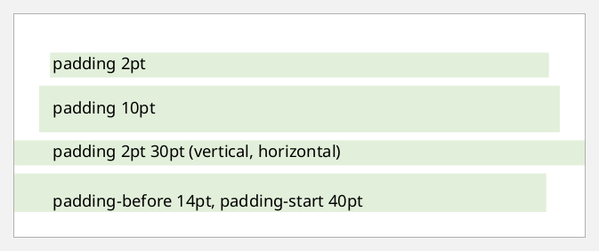
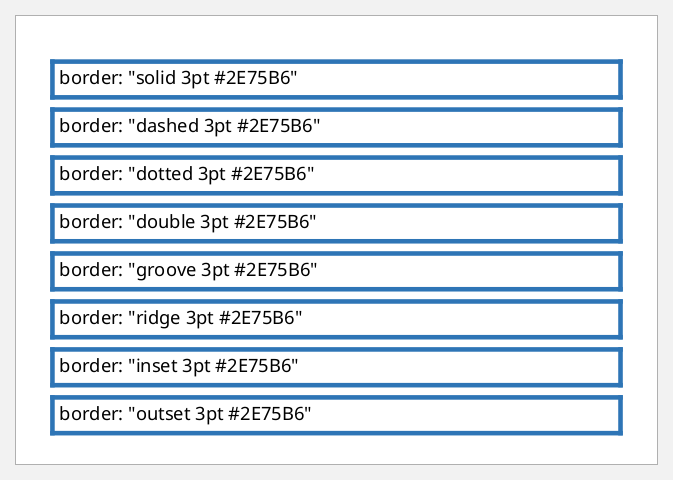
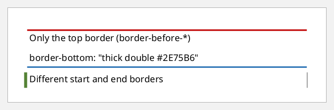
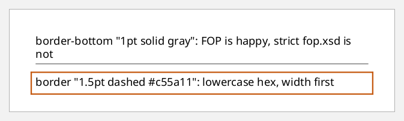
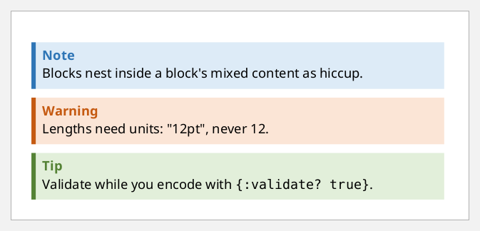
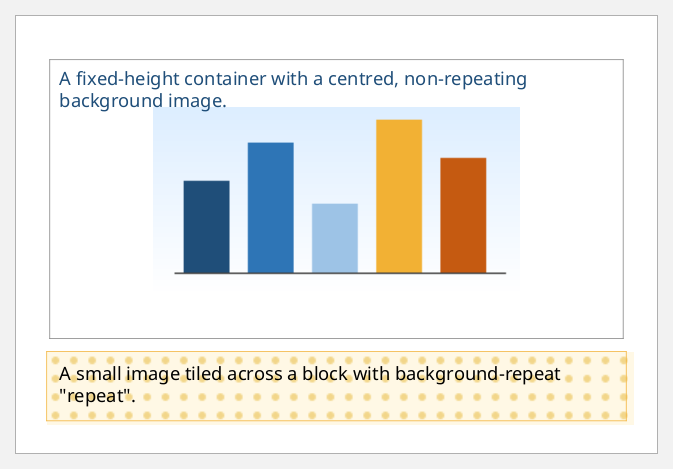

# Spacing, borders and backgrounds

Every block-level element is a box:
- **content**, then **padding**, then a **border**, then the space around the box.
- The space above and below is `:space-before` and `:space-after`, or the
  `:margin-*` properties.
- The space at the sides is `:start-indent` and `:end-indent`.
- `:background-color` and `:background-image` fill the padding box.

## Space between blocks

`:space-before` and `:space-after` separate blocks. Where two meet, the larger
one wins rather than adding up. Here the blocks are coloured so the gaps show:

```clojure example=box-spacing
(defn swatch [props text]
  [:block (merge {:background-color "#DDEBF7" :padding "3pt"} props) text])

[:block {:xml/value [(swatch {} "No space")
                     (swatch {:space-before "12pt"} "space-before 12pt")
                     (swatch {:space-after "6pt"} "space-after 6pt ...")
                     (swatch {:space-before "18pt"} "... space-before 18pt: the gap is 18pt, not 24pt")
                     (swatch {:margin-top "12pt"} "margin-top 12pt behaves like space-before")]}]
```

[](examples/box-spacing.pdf)

`:space-before` has a minimum, an optimum and a maximum, and is dropped at the
top of a page by default. Set `:space-before.conditionality "retain"` to keep
it there.

## Indents

`:start-indent` and `:end-indent` are measured from the edges of the region.
Nested blocks inherit them, so an indent of `"inherited-property-value(start-indent) + 12pt"`
or a plain length both work. Plain lengths keep strict validation happy:

```clojure example=box-indents
[:block {:xml/value [(swatch {} "start-indent 0")
                     (swatch {:start-indent "24pt" :space-before "4pt"} "start-indent 24pt")
                     (swatch {:start-indent "48pt" :end-indent "48pt" :space-before "4pt"} "start-indent and end-indent 48pt")
                     (swatch {:margin-left "72pt" :space-before "4pt"} "margin-left 72pt (CSS-style)")]}]
```

[](examples/box-indents.pdf)

## Padding and background

`:padding` takes one to four lengths, in CSS order (top, right, bottom,
left). The per-side properties also take logical names: `-before`, `-after`,
`-start` and `-end`.

```clojure example=box-padding
[[:block {:background-color "#E2EFDA" :padding "2pt" :space-after "6pt" :xml/value ["padding 2pt"]}]
 [:block {:background-color "#E2EFDA" :padding "10pt" :space-after "6pt" :xml/value ["padding 10pt"]}]
 [:block {:background-color "#E2EFDA" :padding "2pt 30pt" :space-after "6pt" :xml/value ["padding 2pt 30pt (vertical, horizontal)"]}]
 [:block {:background-color "#E2EFDA" :padding-before "14pt" :padding-start "40pt" :xml/value ["padding-before 14pt, padding-start 40pt"]}]]
```

[](examples/box-padding.pdf)

## Borders

The `:border` shorthand sets all four sides. Per-side shorthands such as
`:border-bottom` and `:border-start`, and the longhands
(`:border-before-style`, `:border-before-width`, `:border-before-color`, …),
set one side.

```clojure example=box-border-styles
(def styles ["solid" "dashed" "dotted" "double" "groove" "ridge" "inset" "outset"])

(vec (for [s styles]
       [:block {:border (str s " 3pt #2E75B6") :padding "3pt" :space-after "5pt"
                :xml/value [(str "border: \"" s " 3pt #2E75B6\"")]}]))
```

[](examples/box-border-styles.pdf)

```clojure example=box-border-sides
[[:block {:border-before-style "solid" :border-before-width "2pt" :border-before-color "#C00000"
          :padding "3pt" :space-after "6pt"
          :xml/value ["Only the top border (border-before-*)"]}]
 [:block {:border-bottom "thick double #2E75B6" :padding "3pt" :space-after "6pt"
          :xml/value ["border-bottom: \"thick double #2E75B6\""]}]
 [:block {:border-start-style "solid" :border-start-width "4pt" :border-start-color "#548235"
          :border-end-style "dotted" :border-end-width "1pt" :border-end-color "gray"
          :padding "3pt"
          :xml/value ["Different start and end borders"]}]]
```

[](examples/box-border-sides.pdf)

### Border syntax and strict validation

FOP accepts the CSS-style shorthand in any order, such as `"1pt solid gray"`.
`fop.xsd`'s grammar is narrower:
- `:border` must be written `"style width color"`.
- Per-side shorthands such as `:border-bottom` only accept keyword widths:
  `"thin solid gray"`.
- Colours must be names or *uppercase* `#RRGGBB`.

Idiomatic values validate with `{:lenient? true}` (see
[validation.md](validation.md)):

```clojure example=box-lenient-borders lenient
[[:block {:border-bottom "1pt solid gray" :padding-bottom "2pt" :space-after "8pt"
          :xml/value ["border-bottom \"1pt solid gray\": FOP is happy, strict fop.xsd is not"]}]
 [:block {:border "1.5pt dashed #c55a11" :padding "4pt"
          :xml/value ["border \"1.5pt dashed #c55a11\": lowercase hex, width first"]}]]
```

[](examples/box-lenient-borders.pdf)

## A callout box

Combining it all: a thick start border, a tinted background, padding and
spacing:

```clojure example=box-callout
(defn callout [color tint title & body]
  [:block {:border-start-style "solid" :border-start-width "4pt" :border-start-color color
           :background-color tint :padding "6pt" :space-after "8pt"
           :xml/value (into [[:block {:font-weight "bold" :color color :space-after "2pt"} title]] body)}])

[(callout "#2E75B6" "#DDEBF7" "Note" "Blocks nest inside a block's mixed content as hiccup.")
 (callout "#C55A11" "#FBE5D6" "Warning" "Lengths need units: \"12pt\", never 12.")
 (callout "#548235" "#E2EFDA" "Tip" "Validate while you encode with " [:inline {:font-family "Courier"} "{:validate? true}"] ".")]
```

[](examples/box-callout.pdf)

## Background images

`:background-image` takes a `url(...)`. Relative URLs resolve against the FOP
factory's base URI. `:background-repeat` controls tiling, and
`:background-position-horizontal` and `:background-position-vertical` place
the image. A block's height comes from its content, so this example uses a
`block-container`, which takes a fixed `:height` (see
[block-containers.md](block-containers.md)):

```clojure example=box-background-image
[[:block-container {:background-image "url('images/chart.png')" :background-repeat "no-repeat"
                    :background-position-horizontal "center" :background-position-vertical "center"
                    :border "solid 0.5pt gray" :height "60mm" :padding "6pt"
                    :xml/value [[:block {:color "#1F4E79" :xml/value ["A fixed-height container with a centred, non-repeating background image."]}]]}]
 [:block {:background-image "url('images/tile.png')" :background-repeat "repeat"
          :padding "8pt" :space-before "8pt" :border "solid 0.5pt #F2B134"
          :xml/value ["A small image tiled across a block with background-repeat \"repeat\"."]}]]
```

[](examples/box-background-image.pdf)
