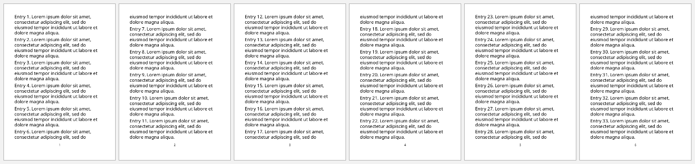
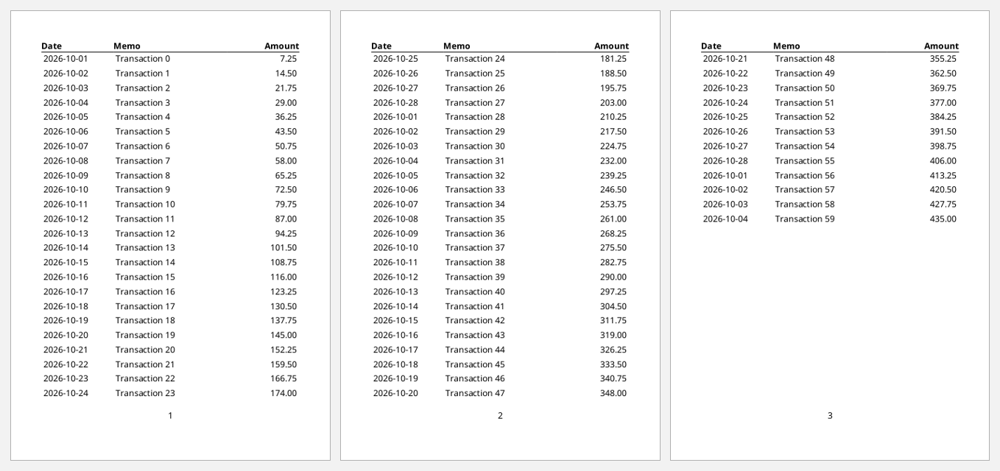
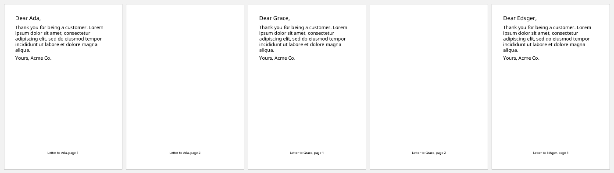
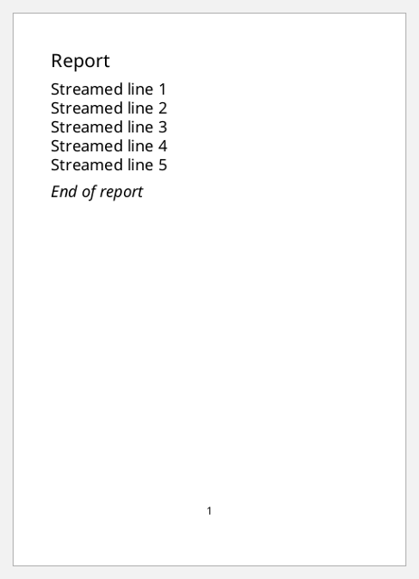

# Streaming

Anywhere a document takes a sequence of elements, you can pass a **stream**
instead of a vector. A stream is a lazy seq, an `eduction`, or any other
`IReduceInit`. Those places include:
- root's `:page-sequence`
- a flow's `:xml/value`
- a table's rows and cells
- a list's items
- mixed content

clj-xml-fo consumes each stream with `reduce`, once. Each item is encoded and
handed to FOP, or to the XML writer, before the next one is produced, so the
document never needs to exist in memory all at once.

The examples below are flagged as streaming in the docs test. They're
validated with `{:validate? true}` while they are encoded, not with `fo/valid?`,
which would consume their streams.

```clojure
(def lorem
  (str "Lorem ipsum dolor sit amet, consectetur adipiscing elit, sed do eiusmod tempor "
       "incididunt ut labore et dolore magna aliqua."))

(def a6-master
  [:simple-page-master {:master-name "a6" :page-width "105mm" :page-height "148mm"
                        :margin "10mm" :region-body {:margin-bottom "8mm"} :region-after {:extent "6mm"}}])

(defn document
  "A one-sequence A6 document whose flow holds items (a vector or a stream)."
  [items]
  [:root {:layout-master-set {:xml/value [a6-master]}
          :page-sequence     [{:master-reference "a6"
                               :static-content [{:flow-name "xsl-region-after"
                                                 :xml/value [[:block {:font-size "8pt" :text-align "center" :xml/value [[:page-number]]}]]}]
                               :flow {:flow-name "xsl-region-body" :xml/value items}}]}])
```

## A streamed flow

The flow's `:xml/value` is an `eduction`, a reducible recipe with nothing
realized up front:

```clojure example=streaming-flow streaming
(document
 (eduction (map (fn [i] [:block {:space-after "4pt" :xml/value [(str "Entry " i ". ") lorem]}]))
           (range 1 41)))
```

[](examples/streaming-flow.pdf)

## Streamed table rows

A table's body rows can stream from any reducible source: a JDBC
`plan`, the lines of a file, a paginated API. The header and the table's
column definitions stay ordinary data:

```clojure example=streaming-table streaming
(defn transaction [i]
  {:date (format "2026-10-%02d" (inc (mod i 28))) :memo (str "Transaction " i) :amount (* (inc i) 7.25)})

(defn txn-row [{:keys [date memo amount]}]
  [:table-row {:table-cell [{:padding "2pt" :xml/value [[:block {:xml/value [date]}]]}
                            {:padding "2pt" :xml/value [[:block {:xml/value [memo]}]]}
                            {:padding "2pt" :text-align "end" :xml/value [[:block {:xml/value [(format "%.2f" amount)]}]]}]}])

(document
 [[:table {:table-layout "fixed" :width "100%" :font-size "8pt"
           :table-column [{:column-width "28%"} {:column-width "44%"} {:column-width "28%"}]
           :table-header {:font-weight "bold" :border-bottom "thin solid black"
                          :xml/value [[:table-row {:table-cell [{:xml/value [[:block {:xml/value ["Date"]}]]}
                                                                {:xml/value [[:block {:xml/value ["Memo"]}]]}
                                                                {:text-align "end" :xml/value [[:block {:xml/value ["Amount"]}]]}]}]]}
           :table-body   [{:xml/value (eduction (map transaction) (map txn-row) (range 60))}]}]])
```

[](examples/streaming-table.pdf)

From a database, with `next.jdbc`:

```clojure no-eval
(require '[next.jdbc :as jdbc])

(with-open [out (io/output-stream "statement.pdf")]
  (fo/render! (statement-document
               (eduction (map txn-row) (jdbc/plan datasource ["select date, memo, amount from txns order by date"])))
              out
              {:validate? true}))
```

The rows are read, encoded and passed to FOP one at a time, inside `with-open`.
FOP still holds a page-sequence until it reaches the end of it; see the note
on memory below.

## One page-sequence per record

`:page-sequence` itself can stream. Batches of letters, invoices or
certificates become one sequence each, with page numbering restarting each
time:

```clojure example=streaming-letters streaming
(def customers [{:name "Ada"} {:name "Grace"} {:name "Edsger"}])

(defn letter [{:keys [name]}]
  {:master-reference "a6" :initial-page-number "1"
   :static-content [{:flow-name "xsl-region-after"
                     :xml/value [[:block {:font-size "8pt" :text-align "center" :xml/value ["Letter to " name ", page " [:page-number]]}]]}]
   :flow {:flow-name "xsl-region-body"
          :xml/value [[:block {:font-size "14pt" :space-after "8pt" :xml/value ["Dear " name ","]}]
                      [:block {:space-after "6pt" :xml/value ["Thank you for being a customer. " lorem]}]
                      [:block {:xml/value ["Yours, Acme Co."]}]]}})

[:root {:layout-master-set {:xml/value [a6-master]}
        :page-sequence     (eduction (map letter) customers)}]
```

[](examples/streaming-letters.pdf)

## Streams among other items

A stream inside a vector of items is spliced in where it sits, as in hiccup.
Fixed content before and after stays plain data:

```clojure example=streaming-spliced streaming
(document
 [[:block {:font-size "14pt" :space-after "6pt" :xml/value ["Report"]}]
  (eduction (map (fn [i] [:block {:xml/value [(str "Streamed line " i)]}])) (range 1 6))
  [:block {:space-before "6pt" :font-style "italic" :xml/value ["End of report"]}]])
```

[](examples/streaming-spliced.pdf)

## Validation while streaming

With `:validate? true`, each streamed item is checked as it arrives, and must be
an element its parent allows. The element around the stream has its
attributes and keys checked. An error names the item's path:

```clojure
(try (fo/xml-string (document (eduction (map (fn [i] (if (= i 3) [:block {:colour "red"}] [:block {}])))
                                        (range 5)))
                    {:validate? true})
     (catch clojure.lang.ExceptionInfo e (select-keys (ex-data e) [:path :errors])))
;; => {:path [1 :page-sequence 0 :flow :xml/value 3 1], :errors [nil {:colour ["disallowed key"]}]}
```

Items already encoded have gone downstream by then: FOP has started on them,
or the XML writer has written them. Validate up front, with `fo/valid?`, when
the data is small enough to hold.

## Streaming XML output

`write-xml!` streams too. XML text reaches the `Writer` or `OutputStream`
as items are encoded. To serve FO over HTTP as it is generated, for example with
Ring:

```clojure no-eval
{:status  200
 :headers {"Content-Type" "application/xml"}
 :body    (ring.util.io/piped-input-stream #(fo/write-xml! doc %))}
```

## Memory

- Use an `eduction` over a reducible source to keep memory flat. A lazy seq
  stays in memory as it is realized, because the document holds its head.
- FOP lays out a page-sequence only once it has read all of it. Long output
  split into several page-sequences lets FOP finish and release each one.
- The schema itself costs a fixed 190–210 MB of heap; see
  [the README](../README.md#memory-and-startup). In one measured run,
  10,000,000 streamed blocks (499 MB of XML) went through `write-xml!` with
  `:validate? true` on a 256 MB heap.
