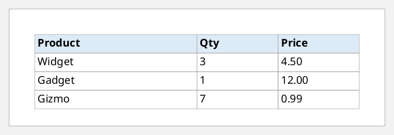
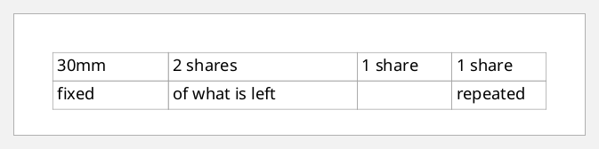
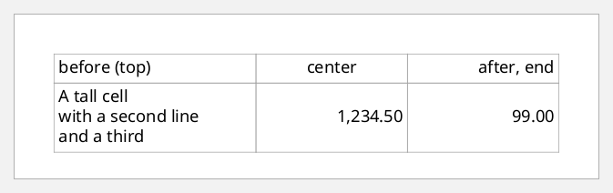
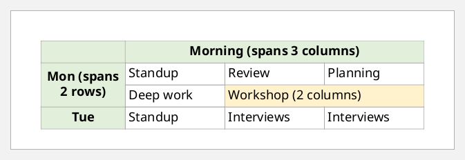
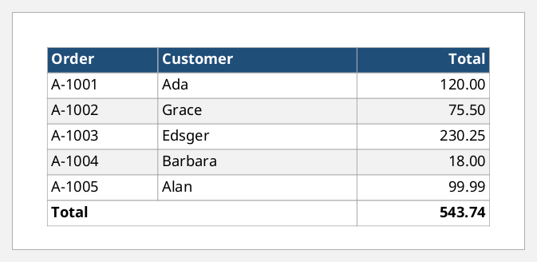
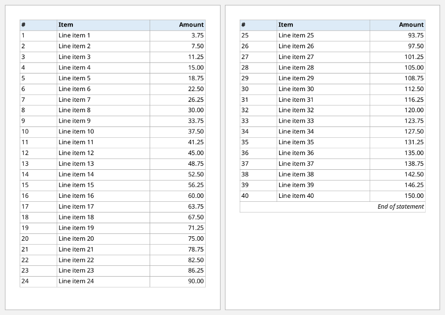
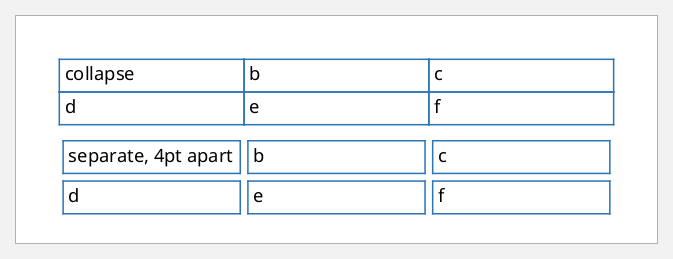

# Tables

A table's parts are keyed children:

| Key | Takes | Holds |
|---|---|---|
| `:table-column` | a vector of maps | one map per column: `:column-width`, and optionally `:number-columns-repeated` |
| `:table-header` | one map | rows that repeat at the top of every page the table spans |
| `:table-footer` | one map | rows that repeat at the bottom |
| `:table-body` | a vector of maps | the rows. Each map's `:xml/value` is a vector of `[:table-row ...]` elements |

Each `table-row` has a vector of `:table-cell` maps. A cell's `:xml/value` holds
blocks, or any other block-level content.

FOP lays out tables with `:table-layout "fixed"` only, so always set it,
together with a `:width`.

These helpers keep the examples short:

```clojure
(defn cell
  "A table-cell content map holding one block."
  ([content] (cell {} content))
  ([props content]
   (merge {:padding "3pt" :border "solid 0.5pt #A6A6A6"}
          props
          {:xml/value [[:block {:xml/value (if (vector? content) content [content])}]]})))

(defn row [& cells]
  [:table-row {:table-cell (vec cells)}])
```

## A basic table

```clojure example=tables-basic
[:table {:table-layout "fixed" :width "100%"
         :table-column [{:column-width "50%"} {:column-width "25%"} {:column-width "25%"}]
         :table-header {:font-weight "bold" :background-color "#DDEBF7"
                        :xml/value [(row (cell "Product") (cell "Qty") (cell "Price"))]}
         :table-body   [{:xml/value [(row (cell "Widget") (cell "3") (cell "4.50"))
                                     (row (cell "Gadget") (cell "1") (cell "12.00"))
                                     (row (cell "Gizmo")  (cell "7") (cell "0.99"))]}]}]
```

[](examples/tables-basic.pdf)

## Column widths

`:column-width` takes a fixed length, a percentage, or
`proportional-column-width(n)`, which shares out whatever is left in proportion
to `n`. `:number-columns-repeated` repeats a column definition:

```clojure example=tables-column-widths
[:table {:table-layout "fixed" :width "100%"
         :table-column [{:column-width "30mm"}
                        {:column-width "proportional-column-width(2)"}
                        {:column-width "proportional-column-width(1)" :number-columns-repeated "2"}]
         :table-body   [{:xml/value [(row (cell "30mm") (cell "2 shares") (cell "1 share") (cell "1 share"))
                                     (row (cell "fixed") (cell "of what is left") (cell "") (cell "repeated"))]}]}]
```

[](examples/tables-column-widths.pdf)

## Alignment

`:text-align` on a cell is inherited by its blocks, so numbers go right with
`"end"`. `:display-align` aligns a cell's content vertically when its row is
taller:

```clojure example=tables-alignment
[:table {:table-layout "fixed" :width "100%"
         :table-column [{:column-width "40%"} {:column-width "30%"} {:column-width "30%"}]
         :table-body   [{:xml/value [(row (cell {:display-align "before"} "before (top)")
                                          (cell {:display-align "center" :text-align "center"} "center")
                                          (cell {:display-align "after" :text-align "end"} "after, end"))
                                     (row (cell ["A tall cell" [:block "with a second line"] [:block "and a third"]])
                                          (cell {:display-align "center" :text-align "end"} "1,234.50")
                                          (cell {:display-align "center" :text-align "end"} "99.00"))]}]}]
```

[](examples/tables-alignment.pdf)

## Spanning rows and columns

`:number-columns-spanned` and `:number-rows-spanned` merge cells. A row that
is spanned into from above simply has fewer cells:

```clojure example=tables-spans
(def head {:font-weight "bold" :background-color "#E2EFDA" :text-align "center"})

[:table {:table-layout "fixed" :width "100%"
         :table-column [{:column-width "22%"} {:column-width "proportional-column-width(1)" :number-columns-repeated "3"}]
         :table-body   [{:xml/value [(row (cell head "")
                                          (cell (assoc head :number-columns-spanned "3") "Morning (spans 3 columns)"))
                                     (row (cell (assoc head :number-rows-spanned "2" :display-align "center") "Mon (spans 2 rows)")
                                          (cell "Standup") (cell "Review") (cell "Planning"))
                                     (row (cell "Deep work") (cell {:number-columns-spanned "2" :background-color "#FFF2CC"} "Workshop (2 columns)"))
                                     (row (cell head "Tue") (cell "Standup") (cell "Interviews") (cell "Interviews"))]}]}]
```

[](examples/tables-spans.pdf)

## Rows from data: zebra stripes and totals

Rows are just a vector, so `map-indexed` makes stripes. The totals go in
`:table-footer`:

```clojure example=tables-zebra
(def orders
  [{:id "A-1001" :customer "Ada"     :total 120.00}
   {:id "A-1002" :customer "Grace"   :total 75.50}
   {:id "A-1003" :customer "Edsger"  :total 230.25}
   {:id "A-1004" :customer "Barbara" :total 18.00}
   {:id "A-1005" :customer "Alan"    :total 99.99}])

(defn money [x] (format "%.2f" (double x)))

(defn order-row [i {:keys [id customer total]}]
  (let [bg {:background-color (if (even? i) "white" "#F2F2F2")}]
    (row (cell bg id) (cell bg customer) (cell (assoc bg :text-align "end") (money total)))))

[:table {:table-layout "fixed" :width "100%"
         :table-column [{:column-width "25%"} {:column-width "45%"} {:column-width "30%"}]
         :table-header {:font-weight "bold" :color "white" :background-color "#1F4E79"
                        :xml/value [(row (cell "Order") (cell "Customer") (cell {:text-align "end"} "Total"))]}
         :table-footer {:font-weight "bold"
                        :xml/value [(row (cell {:number-columns-spanned "2"} "Total")
                                         (cell {:text-align "end"} (money (reduce + (map :total orders)))))]}
         :table-body   [{:xml/value (vec (map-indexed order-row orders))}]}]
```

[](examples/tables-zebra.pdf)

## Headers that repeat on every page

When a table runs over several pages, `:table-header` and `:table-footer` repeat
on each one. `:table-omit-footer-at-break "true"` shows the footer only at the
very end:

```clojure example=tables-repeating-header
[:table {:table-layout "fixed" :width "100%" :table-omit-footer-at-break "true"
         :table-column [{:column-width "20%"} {:column-width "50%"} {:column-width "30%"}]
         :table-header {:font-weight "bold" :background-color "#DDEBF7"
                        :xml/value [(row (cell "#") (cell "Item") (cell {:text-align "end"} "Amount"))]}
         :table-footer {:font-style "italic"
                        :xml/value [(row (cell {:number-columns-spanned "3" :text-align "end"} "End of statement"))]}
         :table-body   [{:xml/value (vec (for [i (range 1 41)]
                                           (row (cell (str i)) (cell (str "Line item " i))
                                                (cell {:text-align "end"} (money (* i 3.75))))))}]}]
```

[](examples/tables-repeating-header.pdf)

## Collapsed and separate borders

By default adjacent cell borders collapse into one. With `:border-collapse "separate"`,
each cell keeps its own border, and `:border-separation` sets the gap between
them:

```clojure example=tables-border-collapse
(defn sample-table [props label]
  [:table (merge {:table-layout "fixed" :width "100%" :space-after "8pt"
                  :table-column [{:column-width "proportional-column-width(1)" :number-columns-repeated "3"}]
                  :table-body [{:xml/value [(row (cell {:border "solid 1pt #2E75B6"} label) (cell {:border "solid 1pt #2E75B6"} "b") (cell {:border "solid 1pt #2E75B6"} "c"))
                                            (row (cell {:border "solid 1pt #2E75B6"} "d") (cell {:border "solid 1pt #2E75B6"} "e") (cell {:border "solid 1pt #2E75B6"} "f"))]}]}
                 props)])

[(sample-table {:border-collapse "collapse"} "collapse")
 (sample-table {:border-collapse "separate" :border-separation "4pt"} "separate, 4pt apart")]
```

[](examples/tables-border-collapse.pdf)

## Anything can go in a cell

A cell's `:xml/value` is element content. It can hold lists, several blocks,
nested tables or images:

```clojure example=tables-rich-cells lenient
[:table {:table-layout "fixed" :width "100%"
         :table-column [{:column-width "35%"} {:column-width "65%"}]
         :table-body   [{:xml/value
                         [[:table-row
                           {:table-cell
                            [{:padding "4pt" :border "solid 0.5pt gray" :display-align "center"
                              :xml/value [[:block {:xml/value [[:external-graphic {:src "url('images/logo.svg')" :content-width "40mm"}]]}]]}
                             {:padding "4pt" :border "solid 0.5pt gray"
                              :xml/value [[:block {:font-weight "bold" :xml/value ["Acme Co."]}]
                                          [:block {:color "gray" :space-after "3pt" :xml/value ["Two blocks and a list in one cell:"]}]
                                          [:list-block {:provisional-distance-between-starts "12pt" :provisional-label-separation "4pt"
                                                        :list-item [{:list-item-label {:end-indent "label-end()" :xml/value [[:block {:xml/value ["•"]}]]}
                                                                     :list-item-body {:start-indent "body-start()" :xml/value [[:block {:xml/value ["Founded 1949"]}]]}}
                                                                    {:list-item-label {:end-indent "label-end()" :xml/value [[:block {:xml/value ["•"]}]]}
                                                                     :list-item-body {:start-indent "body-start()" :xml/value [[:block {:xml/value ["Makes everything"]}]]}}]}]]}]}]]}]}]
```

[](examples/tables-rich-cells.pdf)
