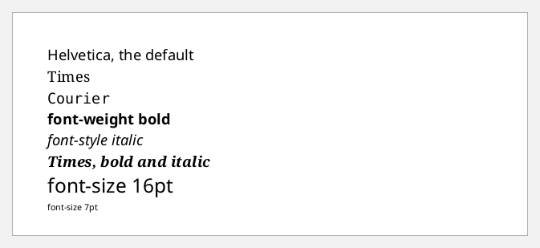
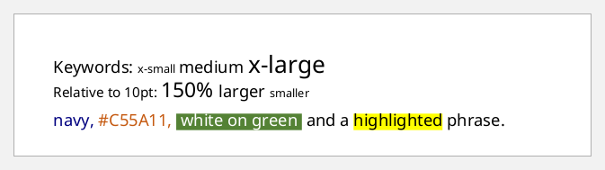
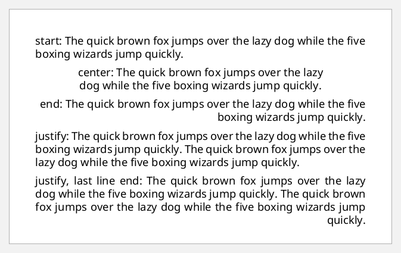
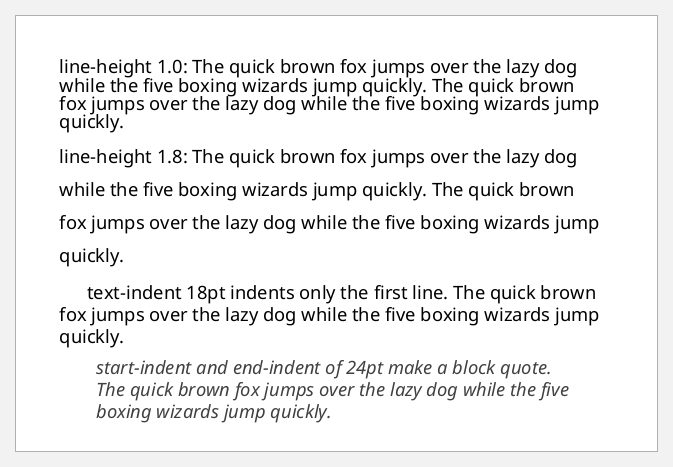
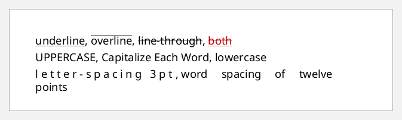
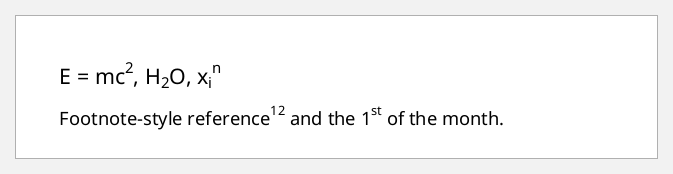
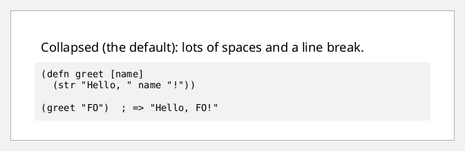
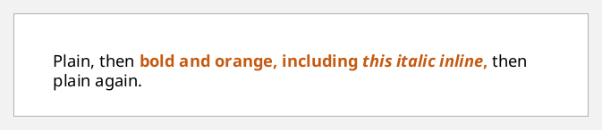
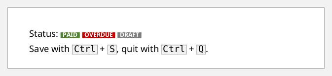

# Text

Text lives in **blocks**, which are paragraphs, and **inlines**, which are
runs inside a paragraph. A block's `:xml/value` is mixed content: strings and
hiccup elements such as `[:inline attrs & children]`. Every property
is inherited by children unless they override it, so set a property on the
block for the whole paragraph or on an inline for a run.

Examples that are a vector of blocks are flow content. The screenshots put
them on an A5 page.

## Fonts

FOP's built-in fonts are the PDF base-14 families: `Helvetica` (the
default, also `sans-serif`), `Times` (`serif`) and `Courier` (`monospace`),
plus `Symbol` and `ZapfDingbats`. Other fonts are configured on the FOP
factory (see [rendering.md](rendering.md)).

```clojure example=text-fonts
(defn sample [props label]
  [:block (assoc props :space-after "3pt" :xml/value [label])])

[(sample {:font-family "Helvetica"} "Helvetica, the default")
 (sample {:font-family "Times"} "Times")
 (sample {:font-family "Courier"} "Courier")
 (sample {:font-weight "bold"} "font-weight bold")
 (sample {:font-style "italic"} "font-style italic")
 (sample {:font-family "Times" :font-weight "bold" :font-style "italic"} "Times, bold and italic")
 (sample {:font-size "16pt"} "font-size 16pt")
 (sample {:font-size "7pt"} "font-size 7pt")]
```

[](examples/text-fonts.pdf)

## Sizes and colours

Sizes can be absolute lengths, keywords (`"x-small"` to `"xx-large"`), or
relative to the parent (`"larger"`, `"smaller"`, percentages). Colours are
names or `#RRGGBB`. A `:background-color` on an inline highlights the run:

```clojure example=text-sizes-colors
[[:block {:xml/value ["Keywords: "
                      [:inline {:font-size "x-small"} "x-small "]
                      [:inline {:font-size "medium"} "medium "]
                      [:inline {:font-size "x-large"} "x-large"]]}]
 [:block {:font-size "10pt"
          :xml/value ["Relative to 10pt: "
                      [:inline {:font-size "150%"} "150% "]
                      [:inline {:font-size "larger"} "larger "]
                      [:inline {:font-size "smaller"} "smaller"]]}]
 [:block {:space-before "6pt"
          :xml/value [[:inline {:color "navy"} "navy, "]
                      [:inline {:color "#C55A11"} "#C55A11, "]
                      [:inline {:color "white" :background-color "#548235"} " white on green "]
                      " and a "
                      [:inline {:background-color "yellow"} "highlighted"]
                      " phrase."]}]]
```

[](examples/text-sizes-colors.pdf)

## Alignment

FOP supports `"start"`, `"center"`, `"end"` and `"justify"` for `:text-align`.
`:text-align-last` sets the last line of a paragraph separately:

```clojure example=text-align
(def sentence "The quick brown fox jumps over the lazy dog while the five boxing wizards jump quickly.")

[[:block {:text-align "start"   :space-after "6pt" :xml/value ["start: " sentence]}]
 [:block {:text-align "center"  :space-after "6pt" :xml/value ["center: " sentence]}]
 [:block {:text-align "end"     :space-after "6pt" :xml/value ["end: " sentence]}]
 [:block {:text-align "justify" :space-after "6pt" :xml/value ["justify: " sentence " " sentence]}]
 [:block {:text-align "justify" :text-align-last "end" :xml/value ["justify, last line end: " sentence " " sentence]}]]
```

[](examples/text-align.pdf)

## Line height and indentation

- `:line-height` is the distance between lines. A plain number multiplies the
  font size.
- `:text-indent` indents the first line.
- `:start-indent` and `:end-indent` move the whole block in from the edges,
  as for a block quote.

```clojure example=text-indent
[[:block {:line-height "1.0" :space-after "6pt"
          :xml/value ["line-height 1.0: " sentence " " sentence]}]
 [:block {:line-height "1.8" :space-after "6pt"
          :xml/value ["line-height 1.8: " sentence " " sentence]}]
 [:block {:text-indent "18pt" :space-after "6pt"
          :xml/value ["text-indent 18pt indents only the first line. " sentence]}]
 [:block {:start-indent "24pt" :end-indent "24pt" :font-style "italic" :color "#404040"
          :xml/value ["start-indent and end-indent of 24pt make a block quote. " sentence]}]]
```

[](examples/text-indent.pdf)

## Decoration, case and spacing

```clojure example=text-decoration
[[:block {:space-after "4pt"
          :xml/value [[:inline {:text-decoration "underline"} "underline"] ", "
                      [:inline {:text-decoration "overline"} "overline"] ", "
                      [:inline {:text-decoration "line-through"} "line-through"] ", "
                      [:inline {:text-decoration "underline line-through" :color "#C00000"} "both"]]}]
 [:block {:space-after "4pt"
          :xml/value [[:inline {:text-transform "uppercase"} "uppercase"] ", "
                      [:inline {:text-transform "capitalize"} "capitalize each word"] ", "
                      [:inline {:text-transform "lowercase"} "LOWERCASE"]]}]
 [:block {:space-after "4pt"
          :xml/value [[:inline {:letter-spacing "3pt"} "letter-spacing 3pt"] ", "
                      [:inline {:word-spacing "12pt"} "word spacing of twelve points"]]}]]
```

[](examples/text-decoration.pdf)

## Superscript and subscript

`:baseline-shift` raises or lowers an inline. Pair it with a smaller font size:

```clojure example=text-baseline-shift
(defn sup [s] [:inline {:baseline-shift "super" :font-size "70%"} s])
(defn sub [s] [:inline {:baseline-shift "sub" :font-size "70%"} s])

[[:block {:font-size "14pt" :space-after "6pt"
          :xml/value ["E = mc" (sup "2") ",  H" (sub "2") "O,  x" (sub "i") (sup "n")]}]
 [:block {:xml/value ["Footnote-style reference" (sup "12") " and the 1" (sup "st") " of the month."]}]]
```

[](examples/text-baseline-shift.pdf)

## Preformatted text and code

By default, runs of spaces and line breaks collapse into single spaces, as in
HTML. To keep them, set:
- `:linefeed-treatment "preserve"` to keep line breaks
- `:white-space-collapse "false"` to keep runs of spaces
- `:white-space-treatment "preserve"` to keep leading spaces
- `:wrap-option "no-wrap"` to stop long lines wrapping

```clojure example=text-code
(def code-sample
  "(defn greet [name]\n  (str \"Hello, \" name \"!\"))\n\n(greet \"FO\")  ; => \"Hello, FO!\"")

[[:block {:xml/value ["Collapsed (the default):    lots   of   spaces\nand a line break."]}]
 [:block {:font-family "Courier" :font-size "9pt" :background-color "#F2F2F2"
          :padding "6pt" :space-before "6pt"
          :linefeed-treatment "preserve" :white-space-collapse "false"
          :white-space-treatment "preserve" :wrap-option "no-wrap"
          :xml/value [code-sample]}]]
```

[](examples/text-code.pdf)

## Wrapper: properties without a box

`[:wrapper ...]` passes inherited properties to its children without making an
area of its own. It's useful when a run of mixed content shares a style:

```clojure example=text-wrapper
[:block {:xml/value ["Plain, then "
                     [:wrapper {:font-weight "bold" :color "#C55A11"}
                      "bold and orange, including "
                      [:inline {:font-style "italic"} "this italic inline"]
                      ","]
                     " then plain again."]}]
```

[](examples/text-wrapper.pdf)

## Characters

`[:character {:character "§"}]` inserts a single character as its own
formatting object. Plain strings work for most text, and `fo:character` is
there when one glyph needs its own properties:

```clojure example=text-character
[:block {:font-size "13pt"
         :xml/value ["See "
                     [:character {:character "§" :font-weight "bold" :color "#2E75B6"}]
                     " 12, "
                     [:character {:character "¶"}]
                     " 3. Copyright "
                     [:character {:character "©"}]
                     " 2026."]}]
```

[](examples/text-character.pdf)

The base-14 fonts cover Western European text (WinAnsi). For other scripts,
symbols or emoji, configure a TrueType or OpenType font
(see [rendering.md](rendering.md#fonts)).

## Inline boxes

Inlines take borders, padding and backgrounds, which is handy for badges and
keyboard keys:

```clojure example=text-inline-boxes
(defn badge [color text]
  [:inline {:background-color color :color "white" :font-weight "bold" :font-size "8pt"
            :padding-start "3pt" :padding-end "3pt"} text])

(defn kbd [k]
  [:inline {:font-family "Courier" :border "solid 0.5pt gray" :background-color "#F2F2F2"
            :padding-start "2pt" :padding-end "2pt"} k])

[[:block {:space-after "6pt"
          :xml/value ["Status: " (badge "#548235" "PAID") " " (badge "#C00000" "OVERDUE") " " (badge "#7F7F7F" "DRAFT")]}]
 [:block {:xml/value ["Save with " (kbd "Ctrl") " + " (kbd "S") ", quit with " (kbd "Ctrl") " + " (kbd "Q") "."]}]]
```

[](examples/text-inline-boxes.pdf)
